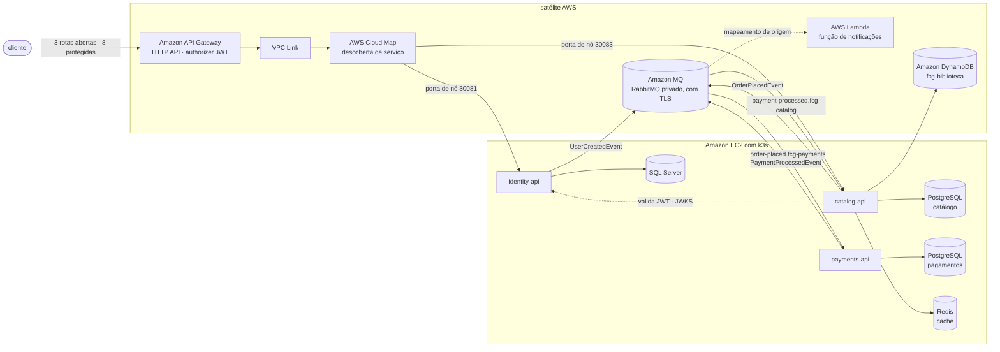
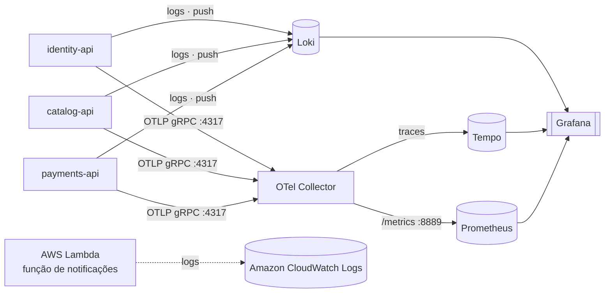

# fcg-ops — orquestração da plataforma FCG

Repositório de **orquestração** da FIAP Cloud Games (FCG). É o guia central da plataforma: reúne a
infraestrutura compartilhada, os artefatos de deploy dos microsserviços, a infraestrutura como
código do satélite de nuvem e os procedimentos de subida de cada ambiente. **Não contém código de
aplicação** — só composição, configuração e orquestração.

A plataforma é **orientada a eventos**: os serviços se comunicam de forma assíncrona por um broker
em **coreografia**, e não orquestração — não há maestro, cada serviço reage ao evento que lhe
interessa e publica o seu; é a distinção que Newman faz em Building Microservices. O preço é não
haver um lugar único onde a saga esteja escrita; o ganho é nenhum serviço precisar conhecer o
próximo.

Ela sobe em **duas camadas**, e a ordem entre elas é o que estrutura todo procedimento deste
repositório:

| Camada | O que é | Como sobe |
|---|---|---|
| **Satélite** | VPC, instância EC2 com endereço fixo, Amazon API Gateway, tabela do DynamoDB, segredo no Secrets Manager e o broker do Amazon MQ | Terraform, em [terraform/](terraform/) |
| **Workloads** | os três serviços, bancos, cache, emulador e a stack de observabilidade | manifestos Kubernetes, em [k8s/](k8s/), aplicados por [scripts/apply-all.sh](scripts/apply-all.sh) |

No laptop só existe a segunda camada — e ela roda igual, contra um cluster local ou contra Docker
Compose, sem credencial de nuvem nenhuma.

---

## Sumário

- [fcg-ops — orquestração da plataforma FCG](#fcg-ops--orquestração-da-plataforma-fcg)
  - [Sumário](#sumário)
  - [Vocabulário](#vocabulário)
  - [Onde cada exigência da fase está](#onde-cada-exigência-da-fase-está)
  - [Arquitetura](#arquitetura)
  - [Telemetria](#telemetria)
  - [A stack, e por que cada peça](#a-stack-e-por-que-cada-peça)
  - [Mapa dos repositórios](#mapa-dos-repositórios)
  - [Subir o ambiente](#subir-o-ambiente)
    - [Local, em forma curta](#local-em-forma-curta)
  - [Notas de arquitetura](#notas-de-arquitetura)
    - [Manifestos centralizados, em vez de `/k8s` por serviço](#manifestos-centralizados-em-vez-de-k8s-por-serviço)
    - [Escolha de controller por tipo de carga](#escolha-de-controller-por-tipo-de-carga)
    - [Configuração em três baldes, e nenhum segredo no git](#configuração-em-três-baldes-e-nenhum-segredo-no-git)
  - [Estrutura do repositório](#estrutura-do-repositório)
  - [Sucessão do serviço de notificações](#sucessão-do-serviço-de-notificações)

---

## Vocabulário

Dito uma vez, para não se repetir depois: o **`UsersAPI`** do enunciado é o **`fcg-identity`** e o
**`CatalogAPI`** é o **`fcg-catalog`**. Os nomes de domínio descrevem melhor o **bounded context**
de cada serviço — identidade e catálogo — que o termo genérico, e **nenhum artefato foi renomeado**
para casar com a rubrica: o dashboard, os logs e as métricas usam os identificadores reais do
sistema, `Fcg.Identity.Api` e `Fcg.Catalog.Api`. Renomear artefato para agradar rubrica é o começo
de um sistema que fala duas línguas.

---

## Onde cada exigência da fase está

| Exigência | Como está atendida | Onde ver |
|---|---|---|
| **Gateway como entrada única, validando JWT** | **Amazon API Gateway** (HTTP API) com **authorizer JWT** nativo, integração privada por **VPC Link** e **AWS Cloud Map**; throttle e log de acesso no stage | [terraform/platform/borda.tf](terraform/platform/borda.tf) |
| **Notificações como função serverless acionada por mensagens da fila** | **AWS Lambda** em repositório próprio, consumindo duas filas do **Amazon MQ** por mapeamento de origem de eventos | repositório [`fcg-notifications-fn`](https://github.com/reinaldogez/fcg-notifications-fn); as filas que ela assina são criadas por [scripts/topologia.sh](scripts/topologia.sh) |
| **Observabilidade — Opção A (Prometheus e Grafana)** | stack de logs, traces e métricas no cluster, alimentada por OTel Collector, com dashboard **provisionado no boot** | [k8s/02-observability/](k8s/02-observability/), [observability/](observability/) e o dashboard [fcg-visao-geral.json](observability/grafana/provisioning/dashboards/fcg-visao-geral.json) |
| **Persistência poliglota: NoSQL e cache distribuído** | read model da biblioteca no **Amazon DynamoDB** (emulador em memória no ambiente local) e cache-aside do catálogo em **Redis** | [terraform/platform/dynamodb.tf](terraform/platform/dynamodb.tf), [k8s/01-infra/dynamodb-local/](k8s/01-infra/dynamodb-local/), [k8s/01-infra/redis/](k8s/01-infra/redis/) e as chaves em [k8s/03-services/catalog/configmap.yaml](k8s/03-services/catalog/configmap.yaml) |

A stack de observabilidade é a **Opção A** — Prometheus e Grafana provisionados por manifesto, sem
serviço externo de terceiros. O dashboard cobre latência, contagem de requisições, distribuição por
código de status e taxa de erro, com os dois serviços de negócio selecionáveis pelo nome.

---

## Arquitetura

O satélite é a fronteira pública e os serviços gerenciados; o cluster é onde os serviços rodam.
**Não há caminho de rede da internet até um serviço fora do gateway**: as portas de nó só aceitam
origem de dentro da rede privada, e é por elas que as interfaces do VPC Link chegam.



**A borda é declarativa e versionada.** As onze rotas estão escritas uma a uma em
[borda.tf](terraform/platform/borda.tf): três abertas — login, cadastro e o documento de descoberta,
sem as quais ninguém obtém token nem valida assinatura — e oito com o authorizer. Não há rota de
captura: caminho não declarado morre no gateway com `404`, sem acordar backend nenhum.

**Duas ausências são estruturais, não esquecimento.** O `payments` não tem rota nem registro de
descoberta: ele é consumidor de eventos, e sua superfície pública seria só um alvo a mais. E não há
rota de health no gateway: a verificação de prontidão publica os nomes das dependências internas,
que não têm por que atravessar a borda.

**O emissor do token é a URL do próprio gateway.** O identity emite com esse emissor, o authorizer o
exige, e o documento de descoberta é servido pelo próprio identity através da rota aberta. O
desenho é circular de propósito — e é por isso que a plataforma nasce em duas fases, descritas em
[docs/levantar-do-zero.md](docs/levantar-do-zero.md).

---

## Telemetria

Os três serviços emitem os mesmos sinais pelos mesmos caminhos: logs por push direto no Loki,
traces e métricas por OTLP no Collector, que roteia traces para o Tempo e expõe métricas para o
Prometheus raspar. O Grafana lê os três.



**A função tem outro destino de log, e isso é consequência de onde ela roda.** Por viver fora do
cluster, ela não alcança a stack in-cluster — seus logs vão para o **Amazon CloudWatch Logs**, junto
com o log de acesso do gateway. Os três serviços continuam no LGTM.

O dashboard **FCG — visão geral** é provisionado no boot do Grafana, a partir de
[observability/grafana/provisioning/dashboards/](observability/grafana/provisioning/dashboards/) —
a mesma fonte servindo Compose e Kubernetes, sem cópia que divirja. São cinco painéis: latência p95
e p50, requisições por serviço, requisições por código de status, taxa de erro 5xx e os 4xx à
parte.

> **O que o dashboard mede é o servidor.** Com o gateway à frente, o que ele barra — o 401 sem
> token, o 404 de rota não declarada — nunca chega a um serviço e não incrementa métrica nenhuma. O
> painel responde *"meus serviços estão saudáveis?"*, não *"o que meus usuários receberam?"*. Para a
> segunda pergunta a fonte é o grupo de log de acesso do gateway, no CloudWatch. A taxa de erro
> conta só 5xx pelo mesmo motivo: somar os 4xx faria a camada de segurança aparecer como falha do
> serviço.

---

## A stack, e por que cada peça

| Peça | Papel | Por que esta |
|---|---|---|
| **k3s** numa instância EC2 · **k3d** no laptop | onde os serviços rodam | mesmo produto nos dois lados: os manifestos que sobem na nuvem são os que rodam local, sem tradução nem camada de template |
| **Docker Compose** | segundo alvo local | caminho mais curto para a plataforma inteira de pé numa máquina, sem cluster |
| **SQL Server** | banco do identity | herdado do monolito da fase anterior, com o schema e as migrations que já existiam |
| **PostgreSQL** (dois) | bancos do catálogo e de pagamentos | um banco por serviço, sem nada compartilhado — o acoplamento entre serviços é só o evento |
| **RabbitMQ** local · **Amazon MQ** (motor RabbitMQ) na nuvem | transporte dos eventos | mesmo protocolo dos dois lados; o que muda é endereço, porta e TLS, e isso é configuração, não código |
| **Amazon DynamoDB** (emulador no local) | read model da biblioteca | a leitura sai da projeção e não do relacional — separação de leitura e escrita, no sentido de CQRS; sob demanda, não cobra parada |
| **Redis** | cache-aside do catálogo | leitura quente sem ir ao banco, com invalidação na escrita |
| **Loki · Tempo · Prometheus · Grafana** | logs, traces e métricas | a Opção A pedida, com os três sinais correlacionáveis na mesma interface |
| **OTel Collector** | coleta de traces e métricas | um ponto de saída dos serviços: trocar o backend não toca aplicação |
| **Amazon API Gateway** (HTTP API) + authorizer JWT | entrada única e validação do token | valida assinatura e audiência na borda, contra o JWKS do emissor, sem plugin nem chave fixa |
| **VPC Link + AWS Cloud Map** | caminho do gateway até o cluster | tráfego privado, e a integração aponta um nome de serviço — a instância pode trocar de endereço sem reescrita |
| **AWS Lambda** + mapeamento de origem de eventos | consumidor de notificações | consumidor que não precisa de servidor de pé para existir |
| **Terraform**, em dois roots | infraestrutura como código | separa o que fica de pé entre sessões do que é cobrado por hora — e o segundo é destruído no fechamento de cada sessão |

---

## Mapa dos repositórios

| Repositório | Papel |
|---|---|
| [`fcg-ops`](https://github.com/reinaldogez/fcg-ops) *(este)* | orquestração: infraestrutura compartilhada, manifestos, Compose, Terraform do satélite e os guias de subida |
| [`fcg-identity`](https://github.com/reinaldogez/fcg-identity) | identidade, autenticação e emissão de JWT |
| [`fcg-catalog`](https://github.com/reinaldogez/fcg-catalog) | catálogo de jogos, pedidos e biblioteca |
| [`fcg-payments`](https://github.com/reinaldogez/fcg-payments) | processamento de pagamento; consumidor, sem superfície pública |
| [`fcg-contracts`](https://github.com/reinaldogez/fcg-contracts) | contratos de evento compartilhados entre os serviços |
| [`fcg-notifications-fn`](https://github.com/reinaldogez/fcg-notifications-fn) | função serverless de notificações, com código e infraestrutura próprios |

As imagens dos serviços são publicadas em `ghcr.io/reinaldogez/fcg-*` e consumidas por tag — os
manifestos e o Compose daqui não compilam nada por padrão.

---

## Subir o ambiente

Quatro caminhos, e o que separa um do outro é **o que você tem na mão**.

| Caminho | Precisa de | Documento |
|---|---|---|
| Ambiente local, Compose ou k3d | só Docker na máquina | **[docs/ambiente-local.md](docs/ambiente-local.md)** |
| Levantar a plataforma de nuvem do zero | credencial de nuvem, uso único por plataforma | **[docs/levantar-do-zero.md](docs/levantar-do-zero.md)** |
| Abrir e fechar uma sessão de nuvem | credencial, com a plataforma já de pé | **[docs/runbook-sessao.md](docs/runbook-sessao.md)** |
| Verificar que a plataforma funciona | um ambiente de pé e Python | **[tests/README.md](tests/README.md)** |

### Local, em forma curta

O caminho mais rápido é o Compose:

```bash
cp .env.example .env                                                 # preencha os valores reais
bash scripts/gen-rsa-key.sh                                          # gera o par de chaves RSA
cp docker-compose.override.example.yml docker-compose.override.yml   # cole o PEM nele
docker compose up -d
```

E o cluster local:

```bash
bash scripts/bootstrap-k3d.sh     # cria o cluster k3d 'fcg'
cp .env.example .env.k3d          # preencha os valores reais
bash scripts/init-secrets.sh      # materializa Secrets e ConfigMaps fora do git
bash scripts/apply-all.sh         # aplica os manifestos em ordem de boot
```

O passo a passo completo — pré-requisitos, os dois fluxos, a materialização dos arquivos
não-versionados, o acesso por encaminhamento de porta, as operações sob demanda e o diagnóstico —
está em [docs/ambiente-local.md](docs/ambiente-local.md).

> **Nenhum dos dois fluxos locais usa credencial de nuvem.** Os dois documentos de nuvem existem
> para quem tem uma; sem ela, a plataforma inteira ainda sobe e é verificável.

---

## Notas de arquitetura

### Manifestos centralizados, em vez de `/k8s` por serviço

A convenção usual coloca uma pasta `/k8s` na raiz de cada repositório de serviço. Aqui os manifestos
estão **centralizados** em [k8s/](k8s/). Não é conflito: `/k8s` por serviço é o **caso base** —
garante que cada serviço seja deployável isoladamente. O repositório de orquestração é a camada
opcional dessa convenção; ao adotá-la, a visão única do sistema e o `apply` de um lugar só vivem
aqui. Cada serviço continua deployável por si: sua imagem vem do registro público, independente de
onde o YAML mora.

### Escolha de controller por tipo de carga

Nenhum recurso é um `Pod` avulso — todo Pod nasce sob um controller que cuida de recriação, ordem e
escala:

| Carga | Controller | Por quê | Recursos |
|---|---|---|---|
| Com estado | **StatefulSet + PVC** | identidade de rede estável e volume que sobrevive ao reinício | `sqlserver-identity`, `postgres-catalog`, `postgres-payments`, `rabbitmq` |
| Sem estado | **Deployment** | réplicas intercambiáveis; estado descartável | `identity-api`, `catalog-api`, `payments-api`, `redis`, `dynamodb-local`, Loki, Tempo, Prometheus, Grafana, OTel Collector |
| Tarefa única | **Job** | roda uma vez até concluir e encerra | `identity-migrate`, `catalog-migrate` (migrations e seed), `payments-migrate`, `catalog-reprojetar` (sob demanda) |

Duas linhas merecem explicação, porque parecem fora do lugar:

- **O `redis` é Deployment, não StatefulSet.** Ele guarda o cache do catálogo, sobre `emptyDir`.
  Perder esse estado num reinício não corrompe nada: a próxima leitura vai ao banco e regrava a
  entrada. Cache que não pode ser perdido não é cache.
- **O `dynamodb-local` também.** O emulador do read model roda em memória, sem volume, de propósito
  — os dados são reconstruíveis a partir do relacional, e a reconstrução é justamente o que se
  demonstra apagando o pod. O Job `catalog-reprojetar` existe para isso, e não faz parte da subida
  automática.

**Nenhum dos dois sobe no perfil de nuvem**, onde o broker e o read model são serviços gerenciados.
Um broker local de pé numa sessão de nuvem seria um destino alternativo silencioso: a configuração
errada conectaria nele, e tudo pareceria funcionar contra um broker vazio.

### Configuração em três baldes, e nenhum segredo no git

Configuração vive no ambiente, não no artefato — o terceiro fator do Twelve-Factor App. Aqui o
critério de corte é mecânico, e evita a classe de erro que só aparece longe da causa:

| Balde | Critério | Versionado |
|---|---|---|
| ConfigMap versionado (`configmap.yaml`) | o valor é **idêntico** nos dois ambientes | sim |
| ConfigMap gerado (`configmap-env.yaml`) | varia por ambiente e **não** é credencial | não |
| Secret gerado (`secret.yaml`) | é credencial ou chave privada | não |

Os arquivos versionados de Secret e de ConfigMap de ambiente carregam **apenas placeholders**, com o
sufixo `.example.yaml`. Os reais são materializados por
[scripts/init-secrets.sh](scripts/init-secrets.sh) a partir do arquivo de variáveis do perfil, que
também fica fora do versionamento. O mesmo vale para o estado do Terraform e para a chave RSA de
assinatura: nada com valor real entra num commit.

O ambiente é selecionado por `FCG_PERFIL`, que aceita `k3d` (padrão) ou `ec2`, e cada perfil tem seu
próprio arquivo de variáveis. Manter um só obrigaria a editar as mesmas chaves a cada troca — e o
esquecimento não dá erro de configuração, dá conexão que falha longe da causa.

---

## Estrutura do repositório

```
fcg-ops/
├── docker-compose.yml                     # stack local completa: infra, observabilidade e os três serviços
├── docker-compose.override.example.yml    # template do override da chave RSA (placeholder)
├── .env.example                           # template das variáveis; copie para .env, .env.k3d ou .env.ec2
├── docs/
│   ├── ambiente-local.md                   # Compose e k3d, do zero ao verde
│   ├── levantar-do-zero.md                 # plataforma de nuvem numa conta virgem (uso único)
│   └── runbook-sessao.md                   # abrir, usar e fechar uma sessão de nuvem
├── scripts/
│   ├── gen-rsa-key.sh                      # gera o par de chaves RSA
│   ├── bootstrap-k3d.sh                    # cria o cluster k3d 'fcg'
│   ├── init-secrets.sh                     # materializa Secrets e ConfigMaps de ambiente
│   ├── apply-all.sh                        # aplica os manifestos em ordem de boot
│   ├── broker-env.sh                       # descobre o broker da sessão e preenche o arquivo de perfil
│   ├── topologia.sh                        # cria exchanges, filas e associações que a função assina
│   └── inventario-aws.sh                   # gate de abertura e fechamento de sessão de nuvem
├── observability/                          # configurações canônicas: Loki, Tempo, Prometheus, Grafana, OTel
├── k8s/
│   ├── 00-namespace.yaml
│   ├── 01-infra/                           # sqlserver-identity, postgres-catalog, postgres-payments,
│   │                                       #   rabbitmq (StatefulSet + PVC), redis e dynamodb-local
│   ├── 02-observability/                   # loki, tempo, prometheus, grafana, otel-collector
│   └── 03-services/
│       ├── identity/                       # configmap, secrets, migrate-job, deployment, service
│       ├── catalog/                        # o mesmo, mais o Job de reconstrução do read model
│       └── payments/                       # o mesmo; consumidor, sem REST de negócio
├── terraform/
│   ├── platform/                           # o que fica de pé: rede, instância, borda, tabela, segredo
│   └── session/                            # o que é cobrado por hora: broker e endpoints, destruído no fechamento
└── tests/                                  # suíte de verificação ponta a ponta
```

---

## Sucessão do serviço de notificações

O serviço de notificações que rodava no cluster foi **descontinuado** e sucedido pela função
serverless do repositório [`fcg-notifications-fn`](https://github.com/reinaldogez/fcg-notifications-fn):
mesmo papel — consumir os eventos e notificar —, agora fora do cluster e acionado pelas filas do
broker. Por isso ele não sobe no Compose nem no k3d, e não há manifesto dele aqui.

A topologia anterior, com os quatro serviços em coreografia dentro do cluster, continua
reproduzível: a tag **`fase-2`** marca o repositório no estado de encerramento daquela fase.

```bash
git checkout fase-2
```
