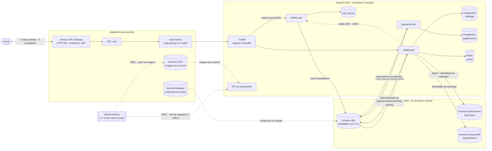
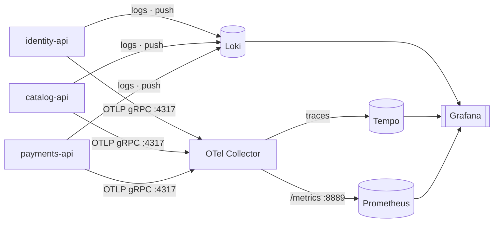

# fcg-ops — orquestração da plataforma FCG

Repositório de **orquestração** da FIAP Cloud Games (FCG). É o guia central da plataforma: reúne a
infraestrutura compartilhada, os artefatos de deploy dos microsserviços, a infraestrutura como
código da nuvem e os procedimentos de subida de cada ambiente. **Não contém código de aplicação**
— só composição, configuração, infraestrutura e orquestração.

A plataforma é **orientada a eventos**: os serviços se comunicam de forma assíncrona por um broker
em **coreografia**, e não orquestração — não há maestro, cada serviço reage ao evento que lhe
interessa e publica o seu; é a distinção que Newman faz em Building Microservices. O preço é não
haver um lugar único onde a saga esteja escrita; o ganho é nenhum serviço precisar conhecer o
próximo.

Na nuvem, **produção existe só durante uma sessão**. O que custa por hora — o cluster Kubernetes
gerenciado, o broker, o motor de busca, a tabela NoSQL — nasce no começo da sessão a partir do
Terraform e dos manifestos daqui, e é destruído no fim. Entre sessões fica de pé só a plataforma
permanente: a borda pública, os repositórios de imagem, as identidades. É infraestrutura
descartável: o ambiente não é cuidado, é recriado — do zero ao primeiro login pela borda, de 22 a
25 minutos, medido em três sessões.

| Camada | O que é | Como sobe |
|---|---|---|
| **Plataforma** | rede, borda (API Gateway → VPC Link → NLB interno), repositórios ECR, identidade federada do pipeline, roles de workload, segredo do broker | Terraform, em [terraform/platform/](terraform/platform/), uma vez por conta |
| **Sessão** | Amazon EKS e seus nós, Amazon MQ, Amazon OpenSearch, a tabela do DynamoDB | Terraform, em [terraform/session/](terraform/session/), a cada sessão |
| **Workloads** | os três serviços, bancos, cache e a stack de observabilidade | manifestos Kubernetes, em [k8s/](k8s/), aplicados por [scripts/apply-all.sh](scripts/apply-all.sh) |

No laptop só existe a terceira camada — e ela roda contra um cluster local ou contra Docker
Compose, sem credencial de nuvem nenhuma.

---

## Sumário

- [Vocabulário](#vocabulário)
- [Onde cada exigência da fase está](#onde-cada-exigência-da-fase-está)
- [Arquitetura](#arquitetura)
- [Ambientes, e o que cada um prova](#ambientes-e-o-que-cada-um-prova)
- [Pipeline de entrega](#pipeline-de-entrega)
- [Segredos](#segredos)
- [Telemetria](#telemetria)
- [A stack, e por que cada peça](#a-stack-e-por-que-cada-peça)
- [Mapa dos repositórios](#mapa-dos-repositórios)
- [Subir o ambiente](#subir-o-ambiente)
- [Notas de arquitetura](#notas-de-arquitetura)
- [Estrutura do repositório](#estrutura-do-repositório)
- [Sucessão do serviço de notificações](#sucessão-do-serviço-de-notificações)

---

## Vocabulário

Dito uma vez, para não se repetir depois: o **`UsersAPI`** do enunciado é o **`fcg-identity`** e o
**`CatalogAPI`** é o **`fcg-catalog`**. Os nomes de domínio descrevem melhor o **bounded context**
de cada serviço — identidade e catálogo — que o termo genérico, e **nenhum artefato foi renomeado**
para casar com a rubrica: o dashboard, os logs e as métricas usam os identificadores reais do
sistema, `Fcg.Identity.Api` e `Fcg.Catalog.Api`. Renomear artefato para agradar rubrica é o começo
de um sistema que fala duas línguas.

---

## Onde cada exigência da fase está

Uma linha por exigência do enunciado da Fase 4. O que mora nos repositórios de serviço aponta para
eles; o resto, para este repositório.

| Exigência | Como está atendida | Onde ver |
|---|---|---|
| **Kubernetes gerenciado** (não IaaS) | **Amazon EKS** 1.37, dois nós gerenciados, criado pelo Terraform a cada sessão e destruído no fechamento | [terraform/session/cluster.tf](terraform/session/cluster.tf), [docs/runbook-sessao.md](docs/runbook-sessao.md) |
| **Registry privado nativo** | **Amazon ECR**, um repositório por serviço, tags **imutáveis** — a tag é o SHA completo do commit | [terraform/platform/registro.tf](terraform/platform/registro.tf) |
| **Exposição por Load Balancer ou Ingress Controller** | **Traefik** como Ingress Controller no cluster, registrado num **NLB interno** por `TargetGroupBinding`; à frente, o **API Gateway** (HTTP API) com authorizer JWT, ligado ao NLB por VPC Link | [k8s/04-borda/ingress.yaml](k8s/04-borda/ingress.yaml), [k8s/eks/](k8s/eks/), [terraform/platform/balanceador.tf](terraform/platform/balanceador.tf), [terraform/platform/borda.tf](terraform/platform/borda.tf) |
| **NoSQL** (MongoDB ou DynamoDB, driver oficial) | **Amazon DynamoDB** com `AWSSDK.DynamoDBv2`: o read model da biblioteca, escrito pela projeção dos eventos de compra e lido no lugar do relacional | [terraform/session/dados.tf](terraform/session/dados.tf); no serviço, [`fcg-catalog` › DynamoDb](https://github.com/reinaldogez/fcg-catalog/tree/main/src/Fcg.Catalog.Infrastructure/DynamoDb) |
| **Cache distribuído** | **Redis** com `IDistributedCache` (`StackExchangeRedis`): cache-aside da leitura do catálogo, com invalidação na escrita | [k8s/01-infra/redis/](k8s/01-infra/redis/); no serviço, [`fcg-catalog` › Cache](https://github.com/reinaldogez/fcg-catalog/tree/main/src/Fcg.Catalog.Infrastructure/Cache) |
| **Busca: motor independente do relacional** | **Amazon OpenSearch** gerenciado, domínio próprio da sessão, assinado por SigV4 com a identidade de workload do catalog | [terraform/session/busca.tf](terraform/session/busca.tf) |
| **Busca: sincronização no CatalogAPI** | criar, editar e desativar jogo publicam um evento interno pela outbox; um consumer do próprio catalog atualiza o índice. O índice também é reconstruído no boot e sob demanda por Job | no serviço, [`fcg-catalog` › Consumers](https://github.com/reinaldogez/fcg-catalog/tree/main/src/Fcg.Catalog.Infrastructure/Consumers); [k8s/03-services/catalog/reindexar-job.yaml](k8s/03-services/catalog/reindexar-job.yaml) |
| **Busca: fuzzy e relevância em `/search`** | `GET /api/jogos/search?q=` com tolerância a erro de digitação e resultado em ordem de relevância, com a pontuação na resposta | no serviço, [`fcg-catalog` › Busca](https://github.com/reinaldogez/fcg-catalog/tree/main/src/Fcg.Catalog.Infrastructure/Busca); a prova pela borda em [tests/borda/test_busca.py](tests/borda/test_busca.py) |
| **CI/CD: build & test, imagem com tag, scan, push, deploy sem downtime** | **GitHub Actions** em cada serviço: testes → imagem com a tag do commit → scan Trivy não bloqueante → push no GHCR e no ECR → Job de migration → rolling update | [`fcg-identity` › .github](https://github.com/reinaldogez/fcg-identity/tree/main/.github), [`fcg-catalog` › .github](https://github.com/reinaldogez/fcg-catalog/tree/main/.github), [`fcg-payments` › .github](https://github.com/reinaldogez/fcg-payments/tree/main/.github); ver [Pipeline de entrega](#pipeline-de-entrega) |
| **`main` = produção** | só o HEAD da `main` é implantado (guarda no deploy); a abertura de sessão sobe a imagem do HEAD de cada serviço e confere | [scripts/imagens-da-main.sh](scripts/imagens-da-main.sh), [docs/runbook-sessao.md](docs/runbook-sessao.md#convergência-com-a-main) |
| **Zero credencial no código e no YAML** | os arquivos versionados de Secret e de ConfigMap de ambiente só têm placeholder (`*.example.yaml`); o valor real é gerado fora do git | [scripts/init-secrets.sh](scripts/init-secrets.sh), [scripts/gerar-env.sh](scripts/gerar-env.sh); ver [Segredos](#segredos) |
| **Injeção de segredos em tempo de execução** | Secrets do Kubernetes por `envFrom`; credencial do broker no **Secrets Manager**; DynamoDB e OpenSearch por **identidade de workload** (EKS Pod Identity), sem chave nenhuma | [terraform/platform/secrets.tf](terraform/platform/secrets.tf), [terraform/platform/iam.tf](terraform/platform/iam.tf), [k8s/03-services/](k8s/03-services/) |

A observabilidade da fase anterior continua: Prometheus, Grafana, Loki e Tempo no cluster, com o
dashboard provisionado — ver [Telemetria](#telemetria).

---

## Arquitetura

**Não há caminho de rede da internet até um serviço fora do gateway.** O balanceador é interno, o
Traefik é `ClusterIP`, e a única entrada é o API Gateway, que chega ao NLB pela rede privada,
pelo VPC Link.



**A borda é declarativa e versionada.** As onze rotas estão escritas uma a uma em
[borda.tf](terraform/platform/borda.tf): três abertas — login, cadastro e o documento de descoberta,
sem as quais ninguém obtém token nem valida assinatura — e oito com o authorizer. Não há rota de
captura: caminho não declarado morre no gateway com `404`, sem acordar backend nenhum. O gateway
decide **se** a requisição entra; o Ingress decide **para qual** serviço ela vai. Divergência entre
os dois falha fechado: rota sem prefixo no Ingress volta `404` do Traefik; prefixo sem rota no
gateway é inalcançável de fora.

**Duas ausências são estruturais, não esquecimento.** O `payments` não tem rota nem prefixo no
Ingress: ele é consumidor de eventos, e sua superfície pública seria só um alvo a mais. E não há
rota de health no gateway: a verificação de prontidão publica os nomes das dependências internas,
que não têm por que atravessar a borda.

**O emissor do token é a URL do próprio gateway.** O identity emite com esse emissor, o authorizer o
exige, e o documento de descoberta é servido pelo próprio identity através da rota aberta. O
desenho é circular de propósito — e é por isso que, numa conta nova, a borda nasce em duas fases,
descritas em [docs/levantar-do-zero.md](docs/levantar-do-zero.md).

**O read model e a busca são projeções, não fonte da verdade.** A biblioteca é lida da tabela do
DynamoDB, escrita pela projeção dos eventos de compra — separação de leitura e escrita, no sentido
de CQRS. O índice de busca é escrito a partir dos eventos de catálogo. Os dois podem ser
reconstruídos do relacional a qualquer momento, por Job, sem apagar nada; é o que torna aceitável
que eles nasçam vazios a cada sessão.

### Plataforma × sessão

| | `terraform/platform/` | `terraform/session/` |
|---|---|---|
| Vida | permanente | uma sessão |
| Conteúdo | VPC e sub-redes; API Gateway, rotas e authorizer; VPC Link; NLB interno e target group; ECR; provedor OIDC do GitHub e as três roles do pipeline; roles de workload; segredo do broker | EKS, nós e add-ons; acessos ao cluster; associações de identidade de workload; Amazon MQ; OpenSearch; tabela do DynamoDB |
| Estado | local, fora do git | local, fora do git — guarda a senha do broker |
| Quem lê quem | — | lê o `platform/` **por nome** (data sources); nunca o contrário |

A separação segue o tempo de vida, e é ela que permite fechar a sessão com um `destroy` de um root
inteiro, sem alvo e sem exceção.

---

## Ambientes, e o que cada um prova

Três ambientes, e cada um responde uma pergunta diferente. Nenhum substitui o seguinte.

| Ambiente | Onde | Para quê | O que prova |
|---|---|---|---|
| **Docker Compose** | laptop | o loop de código | que os serviços sobem juntos, conversam pelo broker e passam pela saga; o caminho mais curto até a plataforma inteira de pé |
| **k3d** | laptop | verificação estrutural dos manifestos | que os mesmos manifestos da nuvem aplicam, que a ordem de boot converge, que o Ingress roteia, que probes, recursos e o RBAC do pipeline fazem sentido — [com uma lista explícita do que ele **não** prova](docs/ambiente-local.md#o-que-o-k3d-não-prova) |
| **EKS** | AWS, só em sessão | produção | tudo o que o k3d não prova: volumes reais, identidade de workload, borda e balanceador, teto de pods por nó, imagens do ECR por commit, busca |

O que o k3d não prova não é detalhe: o volume local escondeu uma permissão que o SQL Server exige
no volume da nuvem, e o emulador do DynamoDB nunca exercita o caminho de credencial do SDK. Item
daquela lista só está pronto quando passa numa sessão de nuvem.

A [suíte de testes](tests/README.md) roda contra qualquer um dos três pela borda — com o endereço
e a senha do ambiente alvo vindos de variável —, e na sessão de nuvem é parte do critério de
sessão aberta.

---

## Pipeline de entrega

O pipeline mora em cada repositório de serviço — `ci.yml` e `cd.yml` em `.github/workflows/`, com
a lógica em `.github/cd/` —, igual nos três. Este repositório não tem pipeline: ele fornece o que
o pipeline consome (os repositórios de imagem, a identidade federada, o RBAC do cluster).

| Evento | O que roda |
|---|---|
| pull request, ou push em outro ramo | testes e análise estática |
| push na `main` | testes → **Imagem** → **Deploy** |

- **Imagem:** build único, scan de vulnerabilidades com Trivy **não bloqueante** (o achado vai
  para o resumo do run, e o run segue verde), e publicação com a **tag do commit**: no GHCR, que
  os ambientes locais consomem, e no ECR, que o cluster consome. A tag do ECR é imutável; um run
  repetido para o mesmo commit pula o build.
- **Deploy:** se há sessão aberta e a stack está de pé, recria o Job de migration a partir do Job
  vivo, com a imagem nova, espera ele terminar, e só então troca a imagem do Deployment. O rolling
  update com `preStop` e `maxUnavailable: 0` troca os pods sem derrubar requisição: medido de
  dentro do cluster, sete deploys pelo pipeline com 7.192 requisições e **0** não-200.
- **Sem sessão:** a imagem é publicada e o deploy é **adiado** com o run verde. A próxima abertura
  de sessão sobe a imagem do HEAD de cada `main`.

**Identidade sem chave guardada.** Cada repositório assume, pelo OIDC do GitHub, uma role própria
(`fcg-cd-<serviço>`), e só a partir da `main` dele — a condição de confiança da role é o
repositório e o ramo. Não existe chave de acesso da AWS em segredo de repositório nenhum. A role
pode publicar no repositório de imagem **do próprio serviço** e descrever o cluster, e nada mais:
o pipeline **não cria infraestrutura**, porque não tem permissão para isso. Dentro do cluster ele
entra num grupo cujo RBAC, só no namespace da aplicação, permite exatamente o que a entrega usa —
Deployments, ReplicaSets, Jobs e a leitura de pods e logs — e nenhum acesso a Secrets nem a
ConfigMaps.

**`main` = produção, e como isso se sustenta:**

- o deploy só implanta se o commit do run **ainda for o HEAD da `main`** — um run atrasado nunca
  sobrescreve um commit mais novo;
- deploys do mesmo repositório rodam **em série**, e **o último vence**;
- nunca `[skip ci]`: commit que não passa pelo pipeline não chega a produção sozinho;
- **rollback é `git revert` + push** — o pipeline entrega o revert como qualquer commit. Se um
  rollout não converge, o próprio job devolve o Deployment à revisão anterior e falha; a correção
  vem por commit novo.

**Como ler um run.** O job de imagem verde é commit publicado; o de deploy verde é *terminado* —
implantado ou adiado, e as anotações dizem qual. A análise estática vermelha não é falha de
entrega: ela não está no caminho da imagem nem do deploy. Step com `continue-on-error` — o scan —
aparece como sucesso mesmo quando acha algo; o que ele achou está nas anotações.

**Risco residual aceito.** Quem pode criar Job no namespace pode montar nele qualquer Secret do
namespace — e o pipeline precisa criar Job, porque a migration roda como Job com as credenciais do
banco. O RBAC que nega leitura de Secret ao pipeline, portanto, não impede um Job escrito para
ler um. O risco é aceito porque não amplia o que já é possível: a identidade do pipeline só é
assumível a partir da `main` do repositório do serviço, e quem consegue pôr um commit na `main`
já consegue implantar código que lê as mesmas credenciais em tempo de execução. A defesa real
está na proteção da `main`, não no RBAC.

---

## Segredos

Nenhuma senha, connection string ou chave privada está no código nem num YAML versionado. Cada
segredo tem uma origem, e nenhuma delas é o git:

| Segredo | De onde vem | Como chega ao serviço |
|---|---|---|
| senhas dos bancos, do Redis, do Grafana, do administrador semeado | arquivo do perfil, **fora do git**: no local, `.env.k3d` preenchido à mão; na nuvem, `.env.eks` **gerado a cada sessão** pelo [`gerar-env.sh`](scripts/gerar-env.sh), com senhas novas, e apagado no fechamento | Secrets do Kubernetes gerados pelo [`init-secrets.sh`](scripts/init-secrets.sh), injetados por `envFrom` |
| chave privada de assinatura dos tokens | `identity-rsa-private.pem` na cópia de quem administra, fora do git | Secret do Kubernetes, gerado pelo mesmo script |
| credencial do broker gerenciado | **AWS Secrets Manager**, segredo permanente com senha gerada no apply do `platform/` | o broker nasce com ela; o [`broker-env.sh`](scripts/broker-env.sh) a lê na abertura e ela segue o caminho dos Secrets acima |
| acesso do catalog ao DynamoDB e ao OpenSearch | **nenhum segredo**: identidade de workload (EKS Pod Identity) da conta de serviço `catalog` | credencial temporária injetada pelo EKS na criação do pod |
| acesso do pipeline à AWS | **nenhum segredo**: OIDC do GitHub, uma role por repositório | credencial temporária do run |

O que é versionado são só os **templates**: `*.example.yaml` para Secret e ConfigMap de ambiente,
`.env.example`, `terraform.tfvars.example` — todos com placeholder. Os estados do Terraform, os
planos salvos e os arquivos de perfil ficam fora do git.

**O que a identidade do pipeline não consegue ler:** Secrets e ConfigMaps do namespace da
aplicação (`kubectl auth can-i get secrets` → `no`, conferido a cada deploy e registrado no
resumo do run), nada fora desse namespace, e nada na AWS além do repositório de imagem do próprio
serviço e da descrição do cluster — nem o Secrets Manager, nem o estado do Terraform. O limite
dessa negação está descrito em [risco residual aceito](#pipeline-de-entrega).

A configuração que **não** é segredo mas varia por ambiente segue a mesma disciplina, em outro
balde — ver [Configuração em três baldes](#configuração-em-três-baldes-e-nenhum-segredo-no-git).

---

## Telemetria

Os três serviços emitem os mesmos sinais pelos mesmos caminhos: logs por push direto no Loki,
traces e métricas por OTLP no Collector, que roteia traces para o Tempo e expõe métricas para o
Prometheus raspar. O Grafana lê os três. A stack é a mesma no local e na sessão de nuvem, dentro
do cluster.



O dashboard **FCG — visão geral** é provisionado no boot do Grafana, a partir de
[observability/grafana/provisioning/dashboards/](observability/grafana/provisioning/dashboards/) —
a mesma fonte servindo Compose e Kubernetes, sem cópia que divirja. São cinco painéis: latência p95
e p50, requisições por serviço, requisições por código de status, taxa de erro 5xx e os 4xx à
parte.

> **O que o dashboard mede é o servidor.** Com o gateway à frente, o que ele barra — o 401 sem
> token, o 404 de rota não declarada — nunca chega a um serviço e não incrementa métrica nenhuma. O
> painel responde *"meus serviços estão saudáveis?"*, não *"o que meus usuários receberam?"*. Para a
> segunda pergunta a fonte é o grupo de log de acesso do gateway, no CloudWatch. A taxa de erro
> conta só 5xx pelo mesmo motivo: somar os 4xx faria a camada de segurança aparecer como falha do
> serviço.

---

## A stack, e por que cada peça

| Peça | Papel | Por que esta |
|---|---|---|
| **Amazon EKS** · **k3d** no laptop | onde os serviços rodam | Kubernetes gerenciado em produção; os mesmos manifestos rodam no k3d, sem tradução nem camada de template — o que muda por ambiente é configuração gerada |
| **Docker Compose** | segundo alvo local | caminho mais curto para a plataforma inteira de pé numa máquina, sem cluster |
| **Amazon API Gateway** (HTTP API) + authorizer JWT | entrada única e validação do token | valida assinatura e audiência na borda, contra o JWKS do emissor, sem plugin nem chave fixa; throttle e log de acesso no stage |
| **VPC Link + NLB interno** | caminho privado do gateway até o cluster | o balanceador não tem endereço público; o target group é do Terraform e sobrevive às sessões, e o cluster só se registra nele |
| **Traefik** | Ingress Controller | despacha por prefixo para o Service certo; o mesmo Ingress roda no k3d e no EKS |
| **Amazon ECR** | registry privado | nativo da nuvem, com tag imutável por commit: a imagem que roda é rastreável até o código |
| **SQL Server** | banco do identity | herdado do monolito da primeira fase, com o schema e as migrations que já existiam |
| **PostgreSQL** (dois) | bancos do catálogo e de pagamentos | um banco por serviço, sem nada compartilhado — o acoplamento entre serviços é só o evento |
| **RabbitMQ** local · **Amazon MQ** (motor RabbitMQ) na nuvem | transporte dos eventos | mesmo protocolo dos dois lados; o que muda é endereço, porta e TLS, e isso é configuração, não código |
| **Amazon DynamoDB** (emulador no local) | read model da biblioteca | a leitura sai da projeção e não do relacional — separação de leitura e escrita, no sentido de CQRS; cobrança sob demanda |
| **Redis** | cache-aside do catálogo | leitura quente sem ir ao banco, com invalidação na escrita |
| **Amazon OpenSearch** | busca do catálogo | motor de busca independente do relacional, com tolerância a erro e relevância nativas; acesso por identidade, sem senha |
| **Loki · Tempo · Prometheus · Grafana** | logs, traces e métricas | os três sinais correlacionáveis na mesma interface, dentro do cluster |
| **OTel Collector** | coleta de traces e métricas | um ponto de saída dos serviços: trocar o backend não toca aplicação |
| **GitHub Actions** | pipeline de entrega | junto do código de cada serviço; entra na AWS por OIDC, sem chave guardada |
| **Terraform**, em dois roots | infraestrutura como código | separa o que fica de pé entre sessões do que é cobrado por hora — e o segundo é destruído inteiro no fechamento de cada sessão |

---

## Mapa dos repositórios

| Repositório | Papel |
|---|---|
| [`fcg-ops`](https://github.com/reinaldogez/fcg-ops) *(este)* | orquestração: infraestrutura compartilhada, manifestos, Compose, Terraform da nuvem e os guias de subida |
| [`fcg-identity`](https://github.com/reinaldogez/fcg-identity) | identidade, autenticação e emissão de JWT; pipeline próprio |
| [`fcg-catalog`](https://github.com/reinaldogez/fcg-catalog) | catálogo de jogos, pedidos, biblioteca (read model no DynamoDB), cache e busca; pipeline próprio |
| [`fcg-payments`](https://github.com/reinaldogez/fcg-payments) | processamento de pagamento; consumidor, sem superfície pública; pipeline próprio |
| [`fcg-contracts`](https://github.com/reinaldogez/fcg-contracts) | contratos de evento compartilhados entre os serviços |
| [`fcg-notifications-fn`](https://github.com/reinaldogez/fcg-notifications-fn) | função serverless de notificações, com código e infraestrutura próprios — ver [Sucessão](#sucessão-do-serviço-de-notificações) |

As imagens dos serviços são publicadas pelo pipeline de cada um em dois lugares: no GHCR
(`ghcr.io/reinaldogez/fcg-*`, `:latest` e `:<commit>`), que o Compose e o k3d consomem, e no ECR,
por commit, que o EKS consome. Os manifestos e o Compose daqui não compilam nada por padrão.

---

## Subir o ambiente

Quatro caminhos, e o que separa um do outro é **o que você tem na mão**.

| Caminho | Precisa de | Documento |
|---|---|---|
| Ambiente local, Compose ou k3d | só Docker na máquina | **[docs/ambiente-local.md](docs/ambiente-local.md)** |
| Abrir, usar e fechar uma sessão de nuvem | credencial de operação, com a plataforma permanente já de pé | **[docs/runbook-sessao.md](docs/runbook-sessao.md)** |
| Levantar a plataforma permanente numa conta nova | credencial de operação, uso único por conta | **[docs/levantar-do-zero.md](docs/levantar-do-zero.md)** |
| Verificar que a plataforma funciona | um ambiente de pé e Python | **[tests/README.md](tests/README.md)** |

### Local, em forma curta

O caminho mais rápido é o Compose:

```bash
cp .env.example .env                                                 # preencha os valores reais
bash scripts/gen-rsa-key.sh                                          # gera o par de chaves RSA
cp docker-compose.override.example.yml docker-compose.override.yml   # cole o PEM nele
docker compose up -d
```

E o cluster local:

```bash
bash scripts/bootstrap-k3d.sh     # cria o cluster k3d 'fcg'
cp .env.example .env.k3d          # preencha os valores reais
bash scripts/init-secrets.sh      # materializa Secrets e ConfigMaps fora do git
bash scripts/apply-all.sh         # aplica os manifestos em ordem de boot
```

O passo a passo completo — pré-requisitos, os dois fluxos, a materialização dos arquivos
não-versionados, o acesso por encaminhamento de porta, as operações sob demanda e o diagnóstico —
está em [docs/ambiente-local.md](docs/ambiente-local.md).

> **Nenhum dos dois fluxos locais usa credencial de nuvem.** Sem ela, a plataforma inteira ainda
> sobe e é verificável — só a busca, que depende do domínio gerenciado, fica desligada.

---

## Notas de arquitetura

### Manifestos centralizados, em vez de `/k8s` por serviço

A convenção usual coloca uma pasta `/k8s` na raiz de cada repositório de serviço. Aqui os manifestos
estão **centralizados** em [k8s/](k8s/). Não é conflito: `/k8s` por serviço é o **caso base** —
garante que cada serviço seja deployável isoladamente. O repositório de orquestração é a camada
opcional dessa convenção; ao adotá-la, a visão única do sistema e o `apply` de um lugar só vivem
aqui. Cada serviço continua deployável por si: o pipeline dele publica a própria imagem e troca a
imagem do próprio Deployment, sem depender de onde o YAML mora.

### Escolha de controller por tipo de carga

Nenhum recurso é um `Pod` avulso — todo Pod nasce sob um controller que cuida de recriação, ordem e
escala:

| Carga | Controller | Por quê | Recursos |
|---|---|---|---|
| Com estado | **StatefulSet + PVC** | identidade de rede estável e volume que sobrevive ao reinício | `sqlserver-identity`, `postgres-catalog`, `postgres-payments`; `rabbitmq` só no local |
| Sem estado | **Deployment** | réplicas intercambiáveis; estado descartável | `identity-api`, `catalog-api`, `payments-api`, `redis`, Loki, Tempo, Prometheus, Grafana, OTel Collector; `dynamodb-local` só no local |
| Tarefa única | **Job** | roda uma vez até concluir e encerra | `identity-migrate`, `catalog-migrate` (migrations e seed), `payments-migrate`; `catalog-reprojetar` e `catalog-reindexar`, sob demanda |

Duas linhas merecem explicação, porque parecem fora do lugar:

- **O `redis` é Deployment, não StatefulSet.** Ele guarda o cache do catálogo, sobre `emptyDir`.
  Perder esse estado num reinício não corrompe nada: a próxima leitura vai ao banco e regrava a
  entrada. Cache que não pode ser perdido não é cache.
- **O `dynamodb-local` também.** O emulador do read model roda em memória, sem volume, de propósito
  — os dados são reconstruíveis a partir do relacional pelo Job `catalog-reprojetar`, que não faz
  parte da subida automática.

**O broker e o emulador não sobem no perfil de nuvem**, onde os dois são serviços gerenciados. Um
broker local de pé numa sessão de nuvem seria um destino alternativo silencioso: a configuração
errada conectaria nele, e tudo pareceria funcionar contra um broker vazio.

**Cada serviço tem um `preStop`** que segura o pod alguns segundos depois de ele sair dos
endpoints, e na nuvem o Traefik tem duas réplicas, um PodDisruptionBudget e um `preStop` mais
longo. É o que
faz o rolling update não perder requisição em voo: sem eles, o pod velho morre antes de o
balanceador parar de mandar tráfego para ele.

### Configuração em três baldes, e nenhum segredo no git

Configuração vive no ambiente, não no artefato — o terceiro fator do Twelve-Factor App. Aqui o
critério de corte é mecânico, e evita a classe de erro que só aparece longe da causa:

| Balde | Critério | Versionado |
|---|---|---|
| ConfigMap versionado (`configmap.yaml`) | o valor é **idêntico** nos dois ambientes | sim |
| ConfigMap gerado (`configmap-env.yaml`) | varia por ambiente e **não** é credencial | não |
| Secret gerado (`secret.yaml`) | é credencial ou chave privada | não |

Os arquivos versionados de Secret e de ConfigMap de ambiente carregam **apenas placeholders**, com o
sufixo `.example.yaml`. Os reais são materializados por
[scripts/init-secrets.sh](scripts/init-secrets.sh) a partir do arquivo de variáveis do perfil, que
também fica fora do versionamento. O mesmo vale para o estado do Terraform e para a chave RSA de
assinatura: nada com valor real entra num commit.

O ambiente é selecionado por `FCG_PERFIL`, que aceita `k3d` (padrão) ou `eks`, e cada perfil tem
seu próprio arquivo de variáveis. Manter um só obrigaria a editar as mesmas chaves a cada troca — e
o esquecimento não dá erro de configuração, dá conexão que falha longe da causa.

---

## Estrutura do repositório

```
fcg-ops/
├── docker-compose.yml                     # stack local completa: infra, observabilidade e os três serviços
├── docker-compose.override.example.yml    # template do override da chave RSA (placeholder)
├── .env.example                           # template das variáveis; copie para .env ou .env.k3d (o .env.eks é gerado)
├── docs/
│   ├── ambiente-local.md                   # Compose e k3d, do zero ao verde, e o que o k3d não prova
│   ├── runbook-sessao.md                   # abrir, usar e fechar uma sessão de nuvem
│   └── levantar-do-zero.md                 # plataforma permanente numa conta nova (uso único)
├── scripts/
│   ├── gen-rsa-key.sh                      # gera o par de chaves RSA
│   ├── bootstrap-k3d.sh                    # cria o cluster k3d 'fcg'
│   ├── gerar-env.sh                        # gera o .env.eks da sessão, com senhas novas
│   ├── init-secrets.sh                     # materializa Secrets e ConfigMaps de ambiente
│   ├── apply-all.sh                        # aplica os manifestos em ordem de boot, por perfil e fase
│   ├── imagens-da-main.sh                  # resolve e confere no ECR a imagem do HEAD da main de cada serviço
│   ├── imagem-eks.sh                       # troca a imagem do GHCR pela do ECR nos manifestos, no perfil eks
│   ├── semear-ecr.sh                       # recuperação: copia do GHCR para o ECR a imagem do mesmo commit
│   ├── preparar-cluster-eks.sh             # classe de disco, controlador de balanceador, Traefik e target group
│   ├── broker-env.sh                       # descobre o broker da sessão e preenche o arquivo de perfil
│   ├── busca-env.sh                        # escreve o endereço do domínio de busca no arquivo de perfil
│   ├── rodar-job-catalog.sh                # Jobs sob demanda do catalog: reprojetar e reindexar
│   ├── fechar-cluster-eks.sh               # esvazia o cluster antes do destroy e limpa o kubeconfig
│   ├── inventario-aws.sh                   # gate de abertura e fechamento de sessão de nuvem
│   └── topologia.sh                        # filas da função de notificações; fora do caminho padrão da sessão
├── observability/                          # configurações canônicas: Loki, Tempo, Prometheus, Grafana, OTel
├── k8s/
│   ├── 00-namespace.yaml
│   ├── 00-acesso/                          # Role e RoleBinding do pipeline de entrega, sem acesso a Secret
│   ├── 01-infra/                           # sqlserver-identity, postgres-catalog, postgres-payments, redis;
│   │                                       #   rabbitmq e dynamodb-local só no perfil local
│   ├── 02-observability/                   # loki, tempo, prometheus, grafana, otel-collector
│   ├── 03-services/
│   │   ├── identity/                       # configmap, secrets, migrate-job, deployment, service
│   │   ├── catalog/                        # o mesmo, mais a conta de serviço e os Jobs reprojetar e reindexar
│   │   └── payments/                       # o mesmo; consumidor, sem REST de negócio
│   ├── 04-borda/                           # o Ingress: prefixo de cada rota para o Service que a atende
│   └── eks/                                # só na nuvem: classe de disco gp3, values do Traefik, TargetGroupBinding
├── terraform/
│   ├── platform/                           # permanente: rede, borda, ECR, OIDC e roles, segredo do broker
│   ├── session/                            # por sessão: EKS, broker, OpenSearch, DynamoDB; destruído no fechamento
│   └── plans/                              # planos salvos (fora do git)
└── tests/                                  # suíte de verificação ponta a ponta pela borda
```

---

## Sucessão do serviço de notificações

O serviço de notificações que rodava no cluster foi **descontinuado** e sucedido pela função
serverless do repositório [`fcg-notifications-fn`](https://github.com/reinaldogez/fcg-notifications-fn):
mesmo papel — consumir os eventos e notificar —, fora do cluster e acionado pelas filas do broker.
Por isso ele não sobe no Compose nem no k3d, e não há manifesto dele aqui.

A função continua no repositório próprio, com código e infraestrutura próprios, e **fica fora do
caminho padrão de sessão desta fase**: a sessão descrita no
[runbook](docs/runbook-sessao.md) sobe os três serviços, o broker, a busca e o read model, e a
compra fecha a saga sem ela. Os eventos que ela consumiria continuam sendo publicados.

O estado anterior do repositório continua reproduzível por tag, como a fase anterior a ele:

- **`fase-2`** — a topologia com os quatro serviços em coreografia dentro do cluster;
- **`fase-3`** — a plataforma com o cluster numa máquina virtual parada entre sessões, a borda
  ligada a ela por descoberta de serviço, e a função de notificações no caminho da sessão.

```bash
git checkout fase-3
```
