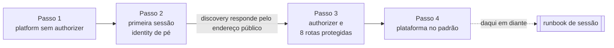

# Levantar a plataforma do zero

> **Uso único por conta.** Este documento levanta a plataforma permanente numa conta onde ela
> não existe. **Sessão de rotina não repete nada daqui** — para abrir e fechar uma sessão com a
> plataforma já de pé, use o [runbook de sessão](runbook-sessao.md).

A distinção não é de conveniência. O passo 1 daqui aplica a borda **sem o authorizer**, e
repeti-lo numa conta que já tem a plataforma derrubaria a autenticação de todas as rotas
protegidas. Depois que a plataforma existe, o padrão do Terraform já é o estado estável
correto, e o interruptor não se usa mais.

## Sumário

- [Quando usar](#quando-usar)
- [A ordem entre camadas, e por que a borda nasce em duas fases](#a-ordem-entre-camadas-e-por-que-a-borda-nasce-em-duas-fases)
- [Passo 1 — plataforma sem authorizer](#passo-1--plataforma-sem-authorizer)
- [Passo 2 — primeira sessão](#passo-2--primeira-sessão)
- [Passo 3 — authorizer e rotas protegidas](#passo-3--authorizer-e-rotas-protegidas)
- [Passo 4 — plataforma no padrão](#passo-4--plataforma-no-padrão)
- [A barra do endereço de teste](#a-barra-do-endereço-de-teste)
- [Desmontar a plataforma](#desmontar-a-plataforma)
- [Expectativa de tempo](#expectativa-de-tempo)
- [Se algo não fechar](#se-algo-não-fechar)

---

## Quando usar

Quando o inventário diz que falta a plataforma. Ele lista, peça por peça, o que tem de estar de
pé entre sessões e o que não pode estar:

```bash
bash scripts/inventario-aws.sh; echo $?
```

`0` é a plataforma completa e nada cobrado por hora sobrando — use o runbook. `2` é peça do
permanente faltando: numa conta nova saem todas as linhas `esperado` como `AUSENTE`, e é aqui
que se começa. `1` é recurso de sessão sobrando, e não se resolve aqui: feche a sessão pelo
runbook primeiro.

Antes do primeiro comando, confira [a máquina de quem
administra](runbook-sessao.md#a-máquina-de-quem-administra): as ferramentas, a credencial de
operação e as armadilhas do Git Bash.

---

## A ordem entre camadas, e por que a borda nasce em duas fases

A plataforma tem duas camadas de Terraform. O `terraform/platform/` é **permanente**: rede,
borda (API Gateway, VPC Link, NLB interno e o target group do Traefik), repositórios de imagem,
a identidade federada do pipeline, as roles de workload e o segredo do broker. O
`terraform/session/` é **efêmero**: nasce e morre a cada sessão, com o cluster, o broker, o
domínio de busca e a tabela do read model. O `session/` lê o `platform/` por nome; nunca o
contrário.

A ordem entre as duas não é preferência — cada passo depende de um efeito observável do
anterior:



A criação do authorizer JWT **valida o documento de discovery do emissor** — não só o formato
do endereço. E quem serve esse documento é o identity, atrás de uma rota aberta do próprio
gateway, dentro de um cluster que só existe durante uma sessão. Numa conta nova não há cluster
quando a borda nasce, e o authorizer não teria o que validar: a criação falha com erro de
requisição inválida, que não diz que falta o discovery.

**Não fecha em uma aplicação**, e nenhuma correção no serviço destrava, porque o problema é de
ordem de criação. A saída são dois interruptores do `platform/`:

| Variável | Padrão | Quando muda |
|---|---|---|
| `authorizer_ligado` | `true` | `false` só no passo 1 desta conta nova e no `plan -destroy` que desmonta a plataforma |
| `verificar_discovery` | `false` | `true` só no passo 3: lê o discovery no plano e avisa, antes do apply, se ele não responde ou se o emissor diverge |

O `verificar_discovery` tem interruptor próprio porque, entre sessões, o cluster não existe: ler
o discovery em todo plano faria o plano falhar no estado normal da plataforma.

---

## Passo 1 — plataforma sem authorizer

Preencha o `terraform/platform/terraform.tfvars` a partir do `terraform.tfvars.example` (região,
prefixo de nome e usuário do broker). O arquivo não é versionado. Os dois interruptores ficam
comentados nele de propósito: o valor vem por `-var` neste passo e no passo 3, e o padrão vale
em todo o resto.

```bash
terraform -chdir=terraform/platform init -input=false
terraform -chdir=terraform/platform plan -input=false -var authorizer_ligado=false \
  -out=../plans/platform-f1.tfplan
```

Plano esperado:

```
Plan: 46 to add, 0 to change, 0 to destroy.
```

Revise o plano antes de aplicar — dimensão, exposição, ciclo de vida — e aplique **o plano
salvo**, nunca com aprovação automática e nunca com `-target`:

```bash
terraform -chdir=terraform/platform apply ../plans/platform-f1.tfplan
```

Sempre com `-chdir`: um `apply` no diretório errado sai `exit 0` com `No changes` e nada
criado.

O `plan` deste passo pode emitir `Warning: Check block assertion known after apply`. É esperado:
a verificação do discovery depende do identificador da API, que ainda não existe no momento do
plano. Com o `verificar_discovery` desligado ela passa calada depois do apply.

**Verificação.** O inventário sai `2`, com **uma** linha `AUSENTE` — `authorizer JWT` — e
nenhum `EXCEDENTE`:

```bash
bash scripts/inventario-aws.sh; echo $?
```

E a borda já responde, falhando fechado:

```bash
API=$(terraform -chdir=terraform/platform output -raw api_issuer)
curl -s -o /dev/null -w '%{http_code}\n' "$API/api/jogos"                       # 404
curl -s -D - -o /dev/null "$API/.well-known/openid-configuration" | grep -iE '^(HTTP|server|apigw-requestid)'
```

| Requisição | Resposta | Por quê |
|---|---|---|
| `GET /api/jogos` | `404` | as rotas protegidas ainda não existem; o gateway não acha rota |
| `GET /.well-known/openid-configuration` | `503`, com `apigw-requestid` e **sem** `server` | a rota aberta existe, mas o NLB não tem alvo: não há cluster. O gateway responde por ele |
| `GET /inexistente` | `404` | caminho não declarado morre no gateway |

Guarde o valor de `api_issuer`: é o **emissor** dos tokens e o endereço público da plataforma.
O output vizinho, `api_invoke_url`, difere dele por uma barra final, e a troca custa caro — ver
[a barra do endereço de teste](#a-barra-do-endereço-de-teste).

**Os repositórios de imagem nascem vazios.** A abertura de sessão exige, no ECR, a imagem do
commit atual da `main` de cada serviço, e não cai para outra se faltar. Numa conta nova há dois
caminhos: um push na `main` de cada serviço, que o pipeline publica no ECR; ou
`bash scripts/semear-ecr.sh`, que copia do GHCR para o ECR a imagem **do mesmo commit** —
nunca outra. O runbook trata o segundo como [ferramenta de
recuperação](runbook-sessao.md#imagens-a-da-main-ou-nenhuma).

---

## Passo 2 — primeira sessão

Siga a [abertura do runbook](runbook-sessao.md#abertura) até a fase de serviços concluir, com
duas diferenças que são só desta primeira vez:

- o inventário de [antes de abrir](runbook-sessao.md#antes-de-abrir) sai `2`, com o
  `authorizer JWT` ausente, em vez de `0` — é o estado esperado depois do passo 1;
- a sessão verde ainda não passa: sem authorizer não há rota protegida, e o login só vira prova
  depois do passo 3.

O plano do `session/` é o mesmo de qualquer sessão — ele não depende do authorizer:

```
Plan: 53 to add, 0 to change, 0 to destroy.
```

O que este passo entrega é o identity de pé, servindo o discovery pelo endereço público.

---

## Passo 3 — authorizer e rotas protegidas

Primeiro a conferência que o authorizer vai fazer, feita por você e de graça:

```bash
API=$(terraform -chdir=terraform/platform output -raw api_issuer)
curl -s "$API/.well-known/openid-configuration"
```

São **duas** conferências, e a segunda é a que escapa: o status tem de ser `200` **e** o campo
`issuer` do corpo tem de ser **igual byte a byte** ao `$API`, sem barra final. Um cluster
configurado com o emissor errado responde `200` alegremente — o `200` sozinho não prova nada —, e
quem paga é o authorizer: ele nasce, e toda rota protegida recusa token válido com `401`.

Com as duas conferências verdes, o plano com a leitura do discovery ligada:

```bash
terraform -chdir=terraform/platform plan -input=false -var verificar_discovery=true \
  -out=../plans/platform-f2.tfplan
```

Plano esperado — o authorizer e as oito rotas protegidas, nada mais:

```
Plan: 9 to add, 0 to change, 0 to destroy.
```

Os nove endereços são `aws_apigatewayv2_authorizer.jwt[0]` e oito `aws_apigatewayv2_route.fcg[...]`
(as rotas `ANY /api/...` e `GET /api/usuarios`). Nenhum `replace`, nenhum outro endereço, e
nenhum aviso do bloco `check` do discovery. Se o aviso aparecer, ele nomeia a causa — discovery
fora do ar, ou emissor divergente — e o certo é **não aplicar**.

```bash
terraform -chdir=terraform/platform apply ../plans/platform-f2.tfplan
terraform -chdir=terraform/platform plan -input=false -detailed-exitcode   # sai 0
```

O `plan` final, **sem `-var` nenhum**, sai `0`: é a prova de que o padrão descreve o estado
estável, e de que nenhum interruptor precisa ser lembrado daqui em diante.

---

## Passo 4 — plataforma no padrão

Volte ao runbook: [sessão verde](runbook-sessao.md#sessão-verde) — agora ela passa inteira — e
[fechamento](runbook-sessao.md#fechamento). O último passo do fechamento é o inventário, e
desta vez ele sai **`0`**:

```bash
bash scripts/inventario-aws.sh; echo $?   # 0
```

É a primeira vez que isso acontece nesta conta: a plataforma está completa, com o authorizer, e
nada cobrado por hora ficou de pé. Com a sessão ainda aberta o inventário não serve de prova —
ele acusa como `EXCEDENTE` tudo o que é da sessão, que é exatamente o que deve estar de pé ali.

Daqui em diante, só o runbook.

---

## A barra do endereço de teste

O `platform/` devolve dois endereços que diferem por uma barra final: `api_issuer` (sem barra)
e `api_invoke_url` (com barra). O de invocação é o que se copia por instinto para montar URL de
teste, e a URL fica com barra dupla:

```
https://<id>.execute-api.us-east-1.amazonaws.com//.well-known/openid-configuration
                                                ↑↑
```

O gateway casa rota por caminho literal, e `//.well-known/{proxy+}` não é
`/.well-known/{proxy+}`: a resposta é **404**, numa rota que existe. O diagnóstico natural é
suspeitar da integração — que está certa. Antes disso, **conte as barras**.

O mesmo erro no emissor é mais caro: um `JWT_ISSUER` com barra produz `401` com token válido em
toda rota protegida. O `gerar-env.sh` recusa emissor terminado em `/` por isso.

Regra prática: `api_issuer` serve para montar URL e para configurar o cluster; `api_invoke_url`
serve para colar no navegador, e nada mais.

---

## Desmontar a plataforma

> **Não exercido na Fase 4.** O procedimento abaixo segue do código e do que foi medido nos
> experimentos que antecederam a fase, mas nunca rodou contra esta plataforma. Revise o plano
> com mais cuidado do que de costume.

1. **A sessão fechada antes.** O `session/` lê o `platform/` por nome — rede, roles, segredo —, e
   destruir o permanente com a sessão de pé deixa o efêmero sem chão. Confira: inventário `0` e
   `terraform -chdir=terraform/session state list` vazio.
2. **O plano de destruição com o authorizer desligado:**

   ```bash
   terraform -chdir=terraform/platform plan -destroy -input=false \
     -var authorizer_ligado=false -out=../plans/platform-destroy.tfplan
   ```

   O desligado é o estado em que a configuração da borda não depende de nada que o cluster
   sirva. Foi medido, nos experimentos, que um `plan -destroy` com a leitura do discovery
   amarrada ao authorizer falhava antes de gerar o plano, porque o discovery já não respondia
   com o cluster fora. Hoje a leitura tem interruptor próprio, desligado por padrão; o
   `authorizer_ligado=false` continua sendo a forma declarada para desmontar a borda.
3. **Os repositórios de imagem recusam a remoção com imagem dentro.** O
   `terraform/platform/registro.tf` declara `force_delete = false`, de propósito: um destroy
   acidental do permanente não leva o histórico de imagens. Para desmontar de verdade, apague
   as imagens de cada repositório antes (`aws ecr list-images` e `aws ecr batch-delete-image`),
   ou aceite que o destroy pare nos repositórios e os trate depois.
4. **Revise o plano e aplique o plano salvo:**

   ```bash
   terraform -chdir=terraform/platform apply ../plans/platform-destroy.tfplan
   ```

O segredo do broker é declarado sem janela de recuperação, então o nome fica livre na hora para
uma plataforma nova.

---

## Expectativa de tempo

Números medidos, cada um de uma execução:

| Etapa | Medido |
|---|---|
| Passo 1 — apply do `platform/` (46 recursos) | 3m19s, dominado por VPC Link (2m07s) e NLB (2m44s) |
| Passo 2 — primeira sessão, do apply do `session/` ao primeiro login pela borda | 24m22s, com o passo 3 no meio |
| Passo 3 — apply do authorizer e das 8 rotas | 17 s |
| Desmontar a plataforma | não medido |

No passo 2 o caminho crítico é o cluster e os nós; o domínio de busca é o recurso mais lento da
sessão (~15 min), mas fica fora do caminho do login. As sessões de rotina seguintes, já sem o
passo 3, mediram 22m41s e 24m11s do zero ao primeiro login.

---

## Se algo não fechar

A seção de [Diagnóstico](runbook-sessao.md#diagnóstico) do runbook de sessão cobre os sintomas
medidos — `401` com token válido, em que camada a resposta morreu, comando que passa por não ter
feito nada, contexto do `kubectl` apontando para cluster destruído. Ela vale igual aqui.

Dois sinais específicos deste documento:

- **Apply longo sem `Still creating`.** Recurso que demora (VPC Link, NLB, cluster, domínio)
  imprime `Still creating...` a cada dez segundos. Se a linha some logo depois do `Creating...`,
  a nuvem recusou o pedido e o Terraform está esperando à toa: consulte o CloudTrail em vez de
  esperar.
- **Aviso do `check` do discovery no passo 3.** É ele que impede o apply de quebrar pela
  metade. Não aplique com o aviso; volte ao passo 2 e confira o emissor no discovery.
