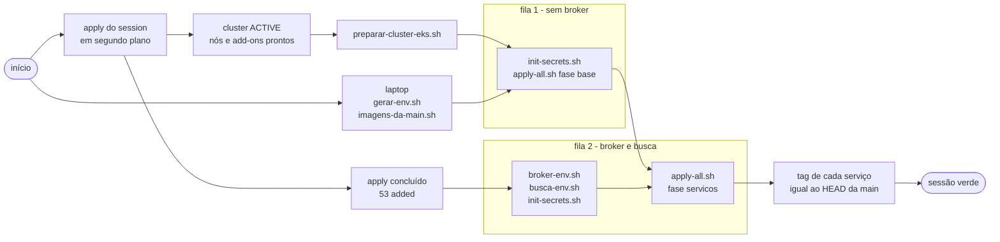

# Runbook de sessão de nuvem

Procedimento para abrir, usar e fechar uma sessão de nuvem da FCG: o ambiente de produção
inteiro, do cluster ao broker, nasce no começo da sessão e morre no fim dela. Este documento
**não** levanta a plataforma permanente — para uma conta onde ela não existe, veja
[levantar-do-zero.md](levantar-do-zero.md).

Salvo indicação em contrário, os comandos rodam **no Git Bash, na raiz da cópia do repositório
que guarda os estados do Terraform**, no laptop de quem administra.

## Sumário

- [Para que serve](#para-que-serve)
- [A máquina de quem administra](#a-máquina-de-quem-administra)
- [Coordenadas](#coordenadas)
- [Antes de abrir](#antes-de-abrir)
- [Abertura](#abertura)
- [Sessão verde](#sessão-verde)
- [Busca na sessão](#busca-na-sessão)
- [Operações sob demanda](#operações-sob-demanda)
- [Pipeline durante a sessão](#pipeline-durante-a-sessão)
- [Medir disponibilidade](#medir-disponibilidade)
- [Grafana](#grafana)
- [Fechamento](#fechamento)
- [O que fica de pé entre sessões](#o-que-fica-de-pé-entre-sessões)
- [Diagnóstico](#diagnóstico)

---

## Para que serve

**Sessão é o intervalo em que produção existe.** Fora dela não há cluster, nem broker, nem
domínio de busca: só a plataforma permanente, que não serve requisição nenhuma além de recusas.
Abrir é criar o ambiente a partir do código; fechar é destruí-lo até o inventário provar que
nada cobrado por hora ficou de pé. A ideia é a da infraestrutura descartável: o ambiente não é
cuidado, é recriado — e por isso o procedimento precisa ser repetível ao pé da letra.

O Terraform tem duas camadas, e a fronteira entre elas é o tempo de vida:

| Camada | Vida | O que mora nela |
|---|---|---|
| `terraform/platform/` | permanente, aplicada uma vez por conta | rede; borda (API Gateway → VPC Link → NLB interno → target group do Traefik); repositórios de imagem; identidade federada do pipeline e as roles de entrega; roles de workload; segredo da credencial do broker |
| `terraform/session/` | nasce e morre a cada sessão | cluster EKS e nós; add-ons; acessos ao cluster; associações de identidade de workload; broker gerenciado; tabela do read model; domínio de busca |

O `session/` lê o `platform/` por nome — nunca por estado remoto, nunca o contrário.

**Estado inicial de toda sessão:** os bancos nascem vazios a cada abertura, e as migrations os
preenchem com o mesmo seed — os jogos do catálogo e a conta `admin@fcg.com`, com a senha
gerada para esta sessão. Todo o resto (usuários, pedidos, biblioteca, índice de busca) é criado
pela própria plataforma a partir daí. Nada sobrevive de uma sessão para a outra, e isso é
intencional: a sessão demonstra o código da `main`, não um estado acumulado.

O procedimento anterior, com o cluster numa máquina virtual parada entre sessões, continua
reproduzível na tag [`fase-3`](https://github.com/reinaldogez/fcg-ops/tree/fase-3/docs/runbook-sessao.md).

---

## A máquina de quem administra

Esta seção é sobre o computador de onde os comandos saem, não sobre a plataforma. Num Linux ou
macOS quase nada da parte do Git Bash se aplica; num Windows, tudo se aplica.

### Ferramentas

As versões com que o procedimento foi provado, ponta a ponta, em sessão:

| Ferramenta | Versão provada | Para quê |
|---|---|---|
| `terraform` | 1.15.8 | os dois roots |
| `aws` (CLI v2) | 2.36.2 | inventário, esperas, consultas |
| `kubectl` | 1.36.1 | o cluster é 1.37, dentro do desvio de versão suportado |
| `helm` | 4.3.1 | controlador de balanceador e Traefik |
| `crane` | 0.22.1 | só o `semear-ecr.sh`, que é ferramenta de recuperação |
| `jq`, `git`, `openssl`, `curl`, Python 3 | — | scripts e a suíte de testes |
| `gh` | — | ler e re-executar runs do pipeline |

O shell de referência é o **Git Bash**. Há três `bash` nesta máquina, e eles não são
intercambiáveis: o do Git para Windows (o que os scripts esperam), o do WSL — outro sistema de
arquivos, que não enxerga a cópia do repositório — e o que o PowerShell resolve por padrão, que
costuma ser o do WSL. Rode tudo de um terminal Git Bash.

### A cópia do repositório e o que só existe nela

A sessão roda de **uma cópia específica** do repositório, porque é nela que estão os arquivos
que o git não guarda — de propósito:

| Arquivo | O que é | Por que não é versionado |
|---|---|---|
| `terraform/platform/terraform.tfstate` e `terraform/session/terraform.tfstate` | os estados dos dois roots | o do `session/` guarda a senha do broker em texto claro |
| `terraform/platform/terraform.tfvars` | as variáveis da plataforma | valores da conta |
| `terraform/plans/` | os planos salvos da sessão | contêm valores sensíveis do estado |
| `.env.eks` | senhas e configuração da sessão | gerado a cada abertura, apagado no fechamento |
| `identity-rsa-private.pem` | chave de assinatura dos tokens | chave privada |
| `tests/.venv` | ambiente da suíte de testes | local da máquina |

Um clone novo não tem nada disso. Trabalhar de outra cópia é abrir uma sessão sem estado — o
`plan` tentaria criar de novo o que já existe.

### Credencial AWS

A credencial é a do usuário de operação, conferida antes de qualquer coisa:

```bash
aws sts get-caller-identity --query Account --output text   # 538003079756
```

O pipeline dos serviços não usa essa credencial nem nenhuma outra guardada: ele entra pela
identidade federada do GitHub, um papel por repositório.

### Git Bash: conversão de caminho, e o comando que mente

O Git Bash roda sobre MSYS, que **reescreve todo argumento começado por `/`** como caminho do
Windows antes de entregá-lo a um executável nativo — e o `aws.exe` é nativo:

```
/aws/apigateway/fcg-api   →   C:/Program Files/Git/aws/apigateway/fcg-api
```

Uns comandos reclamam (`InvalidParameterException`) e você percebe. Outros, como
`aws logs filter-log-events`, **voltam vazios com `exit 0`** — parece que nada aconteceu. Um
comando que passa por não ter feito nada é pior que um que falha.

O conserto é desligar a conversão **só no comando que precisa**, nunca no terminal inteiro:

```bash
MSYS2_ARG_CONV_EXCL='*' aws logs filter-log-events --log-group-name /aws/apigateway/fcg-api ...
```

**Não exporte `MSYS2_ARG_CONV_EXCL`.** Exportada, ela quebra os comandos que dependem da
conversão — `curl -o /dev/null` e `git -C /c/...` entre eles, ambos usados neste documento. O
`inventario-aws.sh` liga a variável dentro dele mesmo, só para os processos
dele, e por isso pode ser chamado direto.

Quando o resultado for "nada aconteceu", confirme por outro caminho antes de concluir — métrica
em vez de log, `describe-*` em vez de `filter-*`.

### Segredo gerado no Git Bash

A saída do `openssl` no Windows pode trazer `\r` no fim, e o `\r` vira parte da senha sem
aparecer em lugar nenhum. Todo segredo gerado à mão passa por `tr -d '\r\n'` (ou nasce dentro de
`$(...)`). Os scripts do repositório já fazem isso; a regra vale para o que for digitado.

### Mais três hábitos

- **`unset GH_TOKEN` antes do `gh`.** Um token inválido no ambiente vence o do chaveiro, e o
  `gh` falha com erro de autenticação que não aponta a variável.
- **Cada `kubectl` do laptop custa uns três segundos.** Aplique por diretório e por script, não
  arquivo a arquivo.
- **Nunca imprima senha nem token.** Leia para variável e use a variável; os comandos deste
  documento seguem essa forma.

---

## Coordenadas

Os valores fixos da plataforma. Os de sessão têm nome fixo e identificador novo a cada abertura.

| Item | Valor |
|---|---|
| Conta / região | `538003079756` / `us-east-1` |
| Endereço público (= emissor dos tokens) | `https://ss1g69q5h9.execute-api.us-east-1.amazonaws.com` — `terraform -chdir=terraform/platform output -raw api_issuer` |
| Cluster EKS | `fcg-eks` (contexto do `kubectl`: `arn:aws:eks:us-east-1:538003079756:cluster/fcg-eks`) |
| Broker gerenciado | `fcg-broker` |
| Domínio de busca | `fcg-busca` |
| Tabela do read model | `fcg-biblioteca` |
| Repositórios de imagem (ECR) | `fcg-identity`, `fcg-catalog`, `fcg-payments` — tags imutáveis, tag = SHA completo do commit |
| Namespace da aplicação | `fcg` |

O endereço público só muda se a plataforma for recriada; o `levantar-do-zero.md` trata disso.
Use sempre o `api_issuer`, **sem barra final** — o output vizinho, `api_invoke_url`, tem a barra
e produz `404` em URL de teste e `401` como emissor.

---

## Antes de abrir

Tudo aqui custa zero: nada foi criado ainda. É onde a sessão se salva.

**1. A `main` atualizada, e o commit anotado.**

```bash
git switch main && git pull --ff-only
git rev-parse HEAD          # anote nas notas da sessão
git status --porcelain      # vazio
```

A sessão sobe o que está na `main` **deste momento**. Anote o commit nas notas da sessão; este
documento não fixa commit nenhum, porque a `main` anda.

Os registros da sessão (planos em texto, saída dos applies, medições) vão para uma pasta fora
da cópia, para não sujar o repositório:

```bash
REG="$HOME/fcg-sessao/$(date -u +%Y%m%d)"; mkdir -p "$REG"
```

**2. A credencial certa** (`aws sts get-caller-identity`, como em [Credencial
AWS](#credencial-aws)).

**3. O inventário sai zero.**

```bash
bash scripts/inventario-aws.sh; echo $?   # 0
```

`0` é a plataforma completa e nada cobrado por hora de pé. `1` é sobra de uma sessão anterior —
exatamente o que este gate existe para pegar: não abra por cima, feche o que sobrou primeiro.
`2` é peça do permanente faltando: o lugar é o [levantar-do-zero.md](levantar-do-zero.md).

**4. O estado do `session/` vazio.**

```bash
terraform -chdir=terraform/session state list   # nenhuma linha
```

Qualquer linha é uma sessão anterior mal fechada. O fechamento dela vem antes desta abertura.

**5. A borda no padrão.**

```bash
terraform -chdir=terraform/platform plan -input=false -detailed-exitcode   # sai 0
```

`0` é o authorizer de pé e nada pendente no permanente. Qualquer outro código pede leitura do
plano antes de seguir.

**6. O plano do `session/`, salvo e revisado.**

```bash
terraform -chdir=terraform/session init -input=false
terraform -chdir=terraform/session plan -input=false -no-color \
  -out=../plans/session.tfplan > "$REG/plano-session.txt" 2>&1
grep '^Plan:' "$REG/plano-session.txt"
```

O plano salvo fica em `terraform/plans/` (fora do git); o texto, em `$REG`. Esperado:

```
Plan: 53 to add, 0 to change, 0 to destroy.
```

Leia o plano: nenhum endereço fora do `session/`, nenhum `replace`. O número muda só com o
fallback da policy de edição do pipeline (`-var cd_politica_edicao=true`, que dá **56**); sem
motivo para ele, 53 é o certo, e qualquer outro número é sinal para parar.

**Nunca `-auto-approve`, nunca `-target`.** Todo `apply` desta sessão é de **plano salvo e
revisado** — o que foi lido é o que se aplica, sem replanejar no meio.

---

## Abertura

A abertura corre em **duas filas**. O apply do `session/` leva uns quinze minutos, e nada do
que o laptop precisa preparar depende dele; e, com o cluster de pé, metade da aplicação —
bancos, cache, observabilidade — não precisa do broker nem da busca. Esperar tudo em série
somaria esperas que se sobrepõem.



### 1. Disparar o apply

```bash
date -u +%Y-%m-%dT%H:%M:%SZ   # anote: início da sessão
terraform -chdir=terraform/session apply -no-color ../plans/session.tfplan \
  > "$REG/apply-session.txt" 2>&1 &
```

Acompanhe o arquivo. Recurso longo — cluster, broker, domínio de busca — imprime
`Still creating...` a cada dez segundos. **Se a linha some logo depois do `Creating...`**, a
nuvem recusou o pedido e o Terraform está esperando à toa: consulte o CloudTrail em vez de
esperar.

### 2. Enquanto isso, o laptop

```bash
bash scripts/gerar-env.sh
bash scripts/imagens-da-main.sh
```

O `gerar-env.sh` escreve o `.env.eks` desta sessão a partir do `.env.example`: senhas novas, o
broker em TLS, o read model gerenciado e o emissor dos tokens apontando para o endereço
público. A saída mostra só os nomes das chaves. Se sobrou um `.env.eks` de uma sessão anterior,
ele recusa — as senhas de um arquivo existente são as dos bancos daquela sessão — e o certo é
`bash scripts/gerar-env.sh --substituir`.

O `imagens-da-main.sh` confere que existe no ECR, para cada serviço, a imagem do commit atual da
`main` do repositório dele. O `apply-all.sh` chama o mesmo script na fase de serviços; rodá-lo
aqui só antecipa a resposta para quando ainda há tempo de agir.

#### Imagens: a da main ou nenhuma

A sessão exige a imagem **do HEAD da `main`** de cada serviço, e **não cai para outra** se ela
faltar: subir uma imagem diferente faria a sessão demonstrar um código que não é o que está no
repositório. Normalmente ela existe, porque o pipeline publica no ECR a cada push na `main`.

Se faltar — o run daquele commit falhou na publicação, ou o repositório de imagem foi
esvaziado —, a ferramenta de recuperação é:

```bash
bash scripts/semear-ecr.sh
```

Ele copia do GHCR para o ECR a imagem que o CI do serviço publicou **para o mesmo commit**, só a
plataforma `linux/amd64`, e pula a tag que já existe. Não constrói nada e não escolhe outra
versão. Precisa do `crane`.

### 3. O cluster pronto

```bash
aws eks describe-cluster --name fcg-eks --query cluster.status --output text   # ACTIVE
NG=$(aws eks list-nodegroups --cluster-name fcg-eks --query 'nodegroups[0]' --output text)
aws eks describe-nodegroup --cluster-name fcg-eks --nodegroup-name "$NG" --query nodegroup.status --output text   # ACTIVE
for a in aws-ebs-csi-driver coredns; do
  aws eks describe-addon --cluster-name fcg-eks --addon-name "$a" --query addon.status --output text   # ACTIVE
done
aws eks list-pod-identity-associations --cluster-name fcg-eks \
  --query 'associations[].[namespace,serviceAccount]' --output text
```

O cluster leva uns dez minutos para sair `ACTIVE`; antes disso a consulta erra por recurso
inexistente, e é só repetir. As associações de identidade de workload têm de listar
`fcg catalog` e `kube-system aws-load-balancer-controller`. A do catalog **precisa existir antes
de qualquer pod do catalog**: a credencial é injetada na criação do pod, e um pod anterior à
associação fica sem ela até ser recriado. A ordem garante isso sozinha — a associação nasce no
apply, e o catalog só sobe na fila 2.

### 4. Preparar o cluster

```bash
bash scripts/preparar-cluster-eks.sh 2>&1 | tee "$REG/preparar.txt"
```

Grava no kubeconfig o contexto do `fcg-eks` (e o deixa como atual), cria a classe de disco
`gp3` padrão, instala o controlador de balanceador e o Traefik, e liga o Traefik ao target group
da borda. Termina com `ok: cluster fcg-eks preparado (2 alvos healthy no target group).` — os
dois alvos saudáveis são o caminho NLB → Traefik pronto.

### 5. Fila 1 — sem broker

```bash
FCG_PERFIL=eks bash scripts/init-secrets.sh
FCG_PERFIL=eks FCG_FASE=base bash scripts/apply-all.sh 2>&1 | tee "$REG/apply-all-base.txt"
```

Bancos, cache, observabilidade e o RBAC do pipeline. O primeiro pull do SQL Server domina o
tempo. O `init-secrets.sh` avisa aqui que a busca está desligada no `catalog-env` — é esperado:
o domínio de busca ainda não terminou de nascer, e a fase base não sobe o catalog.

### 6. O fim do apply

```bash
grep -E '^Apply complete' "$REG/apply-session.txt"
# Apply complete! Resources: 53 added, 0 changed, 0 destroyed.
```

A fila 2 espera o apply inteiro porque o endereço do domínio de busca é output dele. Nas sessões
medidas essa espera custou zero: o apply terminou junto com a preparação do cluster ou antes
dela.

### 7. Fila 2 — broker e busca

```bash
aws mq list-brokers --query "BrokerSummaries[?BrokerName=='fcg-broker'].BrokerState" --output text   # RUNNING
bash scripts/broker-env.sh
bash scripts/busca-env.sh
FCG_PERFIL=eks bash scripts/init-secrets.sh
FCG_PERFIL=eks FCG_FASE=servicos bash scripts/apply-all.sh 2>&1 | tee "$REG/apply-all-servicos.txt"
```

O `broker-env.sh` lê o endereço do broker e a credencial dele no Secrets Manager e os escreve no
`.env.eks` sem imprimir a senha. O `busca-env.sh` lê o output `opensearch_endpoint` do estado
local — sem chamada à nuvem — e escreve o `OPENSEARCH_ENDPOINT`. O `init-secrets.sh` rematerializa
Secrets e ConfigMaps com tudo isso. O `apply-all.sh` aplica identity, catalog e payments, cada
um com o Job de migration concluído antes do Deployment, depois o Ingress, e espera os três
rollouts.

**A barreira da busca.** Na fase de serviços do `eks`, o `apply-all.sh` **recusa** seguir se o
`catalog-env` não tiver o endereço do domínio de busca. Sem ele o catalog sobe saudável, o
rollout passa, e a busca responde `503` — o defeito só apareceria no uso. A recusa vem antes de
qualquer apply e diz o que rodar: `busca-env.sh` e `init-secrets.sh`.

### Se algo falhar no meio

Depois do primeiro `apply`, toda falha tem o mesmo desvio: colha o diagnóstico do ponto que
falhou (`kubectl get pods -A`, os eventos do namespace, o `describe` e o log do pod com problema —
sem imprimir variável de ambiente), consulte o [Diagnóstico](#diagnóstico), e, se não resolver,
**feche a sessão** pelo [Fechamento](#fechamento), inteiro. Uma sessão aberta pela metade cobra
igual a uma inteira. Antes do primeiro `apply` não há o que fechar: pare e investigue.

### Tempos medidos

| Sessão | Do início ao primeiro login pela borda |
|---|---|
| primeira sessão da plataforma (com o authorizer criado no meio) | 24m22s |
| segunda | 22m41s |
| terceira | 24m11s |

O apply do `session/` levou de 15 a 16 minutos. O caminho crítico é o cluster e os nós (de 11 a
13 minutos juntos); o domínio de busca é o recurso mais lento (~15 min), mas fica fora do caminho do
login.

### Convergência com a main

A sessão só demonstra produção se cada serviço estiver rodando **o commit atual da `main`
dele**. A abertura garante isso no momento em que o `apply-all.sh` resolve as imagens — mas um
push que entrou na `main` entre esse momento e a stack ficar de pé não foi implantado. Confira
no fim da abertura, e de novo antes da sessão verde:

```bash
for s in identity catalog payments; do
  head=$(git ls-remote "https://github.com/reinaldogez/fcg-$s.git" refs/heads/main | cut -f1)
  img=$(kubectl get deploy "$s-api" -n fcg -o jsonpath="{.spec.template.spec.containers[?(@.name=='$s-api')].image}")
  [ "${img##*:}" = "$head" ] && echo "ok $s" || echo "DIVERGE $s: implantado ${img##*:}, main $head"
done
```

**Por que pode divergir, e o que fazer.** O job de deploy do pipeline tem duas guardas:

- só implanta se o commit do run **ainda for o HEAD da `main`** — um run atrasado nunca
  sobrescreve um commit mais novo;
- se não há cluster, se o cluster está nascendo ou morrendo, se a stack ainda não está de pé,
  ou se a identidade do pipeline ainda não tem acesso, ele **adia**: termina verde, com a imagem
  publicada, sem tocar o cluster.

Nenhum dos dois casos tenta de novo sozinho. Um push feito durante a abertura cai no segundo:
run verde, imagem no ECR, cluster com o commit anterior. O remédio é **re-executar o run do
HEAD** — a guarda de HEAD passa, porque ele continua sendo o HEAD, e a de stack também, porque
agora ela está de pé:

```bash
unset GH_TOKEN
s=<serviço>
head=$(git ls-remote "https://github.com/reinaldogez/fcg-$s.git" refs/heads/main | cut -f1)
gh run list -R "reinaldogez/fcg-$s" --workflow ci --branch main --limit 10 \
  --json databaseId,headSha,conclusion --jq ".[] | select(.headSha == \"$head\")"
gh run rerun <databaseId> -R "reinaldogez/fcg-$s"
```

A publicação da imagem é pulada na re-execução (a tag já existe no ECR); só o deploy trabalha.
Nunca resolva a divergência aplicando imagem à mão: o pipeline é o único caminho de entrega
para produção.

---

## Sessão verde

Seis provas pela borda, de fora, como um cliente qualquer — e a suíte de testes. Só depois delas
a sessão está aberta.

### Variáveis

```bash
API=$(terraform -chdir=terraform/platform output -raw api_issuer)
SENHA=$(grep '^ADMINSEED_PASSWORD=' .env.eks | cut -d= -f2- | tr -d '\r\n')   # nunca impressa

# devolve só o token; a senha entra pelo stdin do curl, não pela linha de comando
login() {
  printf '{"email":"%s","senha":"%s"}' "$1" "$2" \
    | curl -s -X POST "$API/api/auth/login" -H 'Content-Type: application/json' -d @- \
    | jq -r .accessToken
}
# lê um campo do corpo do token, sem validar assinatura (quem valida é a borda)
campo() {
  printf '%s' "$1" | python -c 'import sys,json,base64; p=sys.stdin.read().split(".")[1]; p+="="*(-len(p)%4); print(json.loads(base64.urlsafe_b64decode(p))[sys.argv[1]])' "$2"
}
```

### Borda ou serviço: os cabeçalhos

Um `401` do gateway e um `401` do serviço têm o mesmo código e causas opostas. O que separa os
dois são os cabeçalhos:

| Cabeçalhos | Quem respondeu |
|---|---|
| `apigw-requestid` presente, **sem** `server` | o gateway — a requisição morreu na borda, o serviço nunca acordou |
| `server: Kestrel` | o serviço — a requisição atravessou gateway → VPC Link → NLB → Traefik → Ingress e foi recusada (ou atendida) por ele |

As provas abaixo usam essa distinção: não basta o código certo, ele tem de vir da camada certa.

### As seis provas

**1. Rota protegida sem token morre no gateway.**

```bash
curl -si "$API/api/jogos" | grep -iE '^(HTTP|server|apigw-requestid)'
# HTTP/1.1 401 ... com apigw-requestid, sem server
```

**2. Login do administrador, e o token certo.**

```bash
TOKEN_ADMIN=$(login admin@fcg.com "$SENHA")
campo "$TOKEN_ADMIN" iss   # igual ao $API, byte a byte
campo "$TOKEN_ADMIN" aud   # fcg
```

O emissor do token tem de ser exatamente o endereço público: é contra ele que o authorizer
valida. Anote a hora — é o **primeiro login pela borda**, o marco do tempo de abertura.

**3. O discovery responde pelo endereço público.**

```bash
curl -s "$API/.well-known/openid-configuration" | jq -r .issuer   # igual ao $API
```

**4. Rota protegida com token chega ao serviço.**

```bash
curl -si "$API/api/jogos" -H "Authorization: Bearer $TOKEN_ADMIN" | grep -iE '^(HTTP|server)'
# HTTP/1.1 200, server: Kestrel
```

**5. A saga pela borda.** Um usuário novo, uma compra, a biblioteca:

```bash
EMAIL="sessao-$(date +%s)@fcg.test"; SENHA_U='SenhaE2E@2026'   # conta descartável
printf '{"nome":"Usuario Sessao","email":"%s","senha":"%s"}' "$EMAIL" "$SENHA_U" \
  | curl -s -o /dev/null -w '%{http_code}\n' -X POST "$API/api/usuarios" \
      -H 'Content-Type: application/json' -d @-                         # 201
TOKEN=$(login "$EMAIL" "$SENHA_U")
USUARIO=$(campo "$TOKEN" sub)
JOGO=$(curl -s "$API/api/jogos?pagina=1&tamanhoPagina=100" -H "Authorization: Bearer $TOKEN" \
  | jq -r '[.[] | select(.ativo and .preco <= 5000)] | min_by(.preco) | .id')
PEDIDO=$(printf '{"jogoId":"%s"}' "$JOGO" \
  | curl -s -X POST "$API/api/pedidos" -H "Authorization: Bearer $TOKEN" \
      -H 'Content-Type: application/json' -d @- | jq -r .id)            # 202, Pendente
for i in $(seq 1 15); do
  st=$(curl -s "$API/api/pedidos/$PEDIDO" -H "Authorization: Bearer $TOKEN" | jq -r .status)
  [ "$st" != Pendente ] && break; sleep 2
done; echo "$st"                                                         # Aprovado
curl -s "$API/api/biblioteca/$USUARIO" -H "Authorization: Bearer $TOKEN" | jq length   # 1
aws dynamodb query --table-name fcg-biblioteca \
  --key-condition-expression 'PK = :pk' \
  --expression-attribute-values "{\":pk\":{\"S\":\"USER#$USUARIO\"}}" --query Count   # 1
```

A compra atravessa o broker duas vezes — catalog publica o pedido, payments decide e publica o
resultado, catalog credita a biblioteca —, e o item na tabela do DynamoDB foi escrito pela
identidade de workload do catalog: o nó não tem permissão nenhuma na tabela. Nas sessões
medidas, o pedido saiu `Aprovado` em 1 a 2,2 segundos.

**6. Caminho inexistente morre no gateway.**

```bash
curl -si "$API/inexistente" | grep -iE '^(HTTP|server)'   # 404, sem server
```

### A suíte da borda

```bash
cd tests && FCG_API_BASE_URL="$API" FCG_ADMIN_PASSWORD="$SENHA" \
  FCG_RSA_PRIVATE_KEY_PATH="$(cygpath -w "$PWD/../identity-rsa-private.pem")" \
  .venv/Scripts/pytest borda -v 2>&1 | tee "$REG/pytest-borda.txt"; cd ..
```

Esperado: **34 passed**, incluindo os 4 da busca (marcador `busca`) e os de token forjado — a
chave de assinatura do `eks` é a mesma `identity-rsa-private.pem` da cópia. Teste que falhar
tem de ser classificado antes de qualquer outra coisa: defeito de plataforma, ou premissa do
teste que a plataforma mudou. O [README da suíte](../tests/README.md) explica cada um.

Com as seis provas e a suíte verdes, a sessão está aberta.

---

## Busca na sessão

A busca do catálogo é uma projeção num índice próprio, e não a fonte da verdade. Por isso ela
pode estar quebrada com o serviço saudável: o catalog sobe, o rollout passa, a listagem
responde — e só `GET /api/jogos/search` devolve `503`. O que diz o estado dela é o log do boot
do catalog.

```bash
kubectl logs deploy/catalog-api -n fcg | grep -E 'Busca desligada|Cluster de busca|índice de busca'
```

| Linha | O que significa |
|---|---|
| `Cluster de busca disponível; preparando o índice.` | o catalog alcançou o domínio, com assinatura e identidade aceitas |
| `Reconstrução do índice de busca concluída — N indexados, M removidos.` | o índice foi preenchido a partir do banco no boot. Numa sessão nova, `N` é o número de jogos do seed (medido: `22 indexados, 0 removidos`), cerca de um segundo depois da linha anterior |
| `Cluster de busca indisponível; nova tentativa a cada …` | o domínio ainda não respondia; o catalog tenta de novo sozinho. Aceitável **antes** da linha de disponível |
| `Reconstrução automática do índice de busca falhou; o remédio é a reconstrução manual.` | o índice não foi preenchido; o serviço segue de pé. Remédio: [reindexar](#operações-sob-demanda) |
| `Busca desligada: OpenSearch:Endpoint ausente.` | o `catalog-env` chegou sem o endereço do domínio. Na sessão não devia acontecer — a barreira do `apply-all.sh` existe para isso; ver [Diagnóstico](#busca-responde-503) |

A reconstrução no boot só preenche índice **vazio** (com índice já preenchido, a linha é
`Índice de busca já preenchido; reconstrução pulada.`). Numa sessão nova o índice sempre nasce
vazio, junto com o domínio.

A saúde, de dentro do cluster — o health agregado do catalog tem um check `opensearch`:

```bash
kubectl run saude-catalog -n fcg --rm -i --restart=Never --image=curlimages/curl:8.11.1 \
  -- curl -s http://catalog-api/health
# ... {"name":"opensearch","status":"Healthy"} ...
```

Pela borda, a prova é a mesma da suíte: `search?q=witcer` (com erro de digitação de propósito)
traz *The Witcher 3: Wild Hunt* em primeiro, com `relevancia`; um termo que casa com vários
jogos traz todos, em relevância não crescente. Uma edição no catálogo aparece na busca em
segundos — medido: criação visível em 3,1 s, troca de título em 1,2 s, desativação fora do
resultado em 0,5 s.

---

## Operações sob demanda

Dois Jobs do catalog que não fazem parte da subida, de propósito: rodam quando alguém pede.

```bash
FCG_PERFIL=eks bash scripts/rodar-job-catalog.sh reprojetar
FCG_PERFIL=eks bash scripts/rodar-job-catalog.sh reindexar
```

O `FCG_PERFIL=eks` não é opcional: o padrão do script é `k3d`, e a guarda de contexto dele
recusa o perfil que não casa com o cluster atual — um Job de um ambiente rodado no outro
escreveria no índice ou no read model errado.

| Job | O que faz | Quando usar |
|---|---|---|
| `reprojetar` | relê a biblioteca no banco relacional e a reescreve na tabela do read model, pela mesma porta de escrita do caminho de evento; termina com `Reconstrução da biblioteca concluída — N projetados, M pulados.` | o read model ficou para trás do relacional |
| `reindexar` | relê o catálogo do banco relacional e reescreve o índice de busca: indexa os ativos, remove os desativados | o domínio de busca caiu ou ficou inalcançável no meio da sessão e voltou; a reconstrução automática do boot falhou |

Os dois **nunca apagam** nada do banco relacional, que é a fonte da verdade — só reescrevem a
projeção a partir dele. Medido numa sessão: `reindexar` em ~5 s, com
`Reconstrução do índice de busca concluída — 22 indexados, 1 removidos.` — exatamente os 22
jogos ativos e o 1 desativado que a listagem mostrava naquele momento.

O script:

1. lê a imagem que o `catalog-api` **está servindo agora** — o Job roda o mesmo código que
   atende as requisições, e não o HEAD da `main`, que pode estar à frente do implantado;
2. confere que ela tem a forma do perfil (no `eks`, ECR com tag de commit);
3. apaga o Job anterior — Job concluído não roda de novo —, aplica, e espera `Complete` ou
   `Failed` (teto de 300 s);
4. imprime as últimas linhas do log e a imagem usada. Sai `0` só com `Complete`.

**O log de um Job que falhou.** Quando o Job estoura as tentativas, o controlador **apaga o
pod**, e com ele o log: ler depois do `Failed` não acha nada. Por isso o script guarda o log a
cada sondagem e, se o pod já sumiu, mostra o último que leu, avisando
(`o pod do Job já não existe; último log lido durante a espera`).

**Não há operação para apagar o índice** a partir do cluster: a policy do domínio de busca só
aceita a identidade do catalog. A reconstrução cobre o caso real — índice desatualizado —
sem precisar disso.

---

## Pipeline durante a sessão

O pipeline mora em cada repositório de serviço (`fcg-identity`, `fcg-catalog`, `fcg-payments`),
não aqui. Ele roda com ou sem sessão aberta; o que muda é até onde a entrega chega.

**Em push na `main`:** testes → **Imagem** (build, scan não bloqueante, publicação no GHCR e no
ECR com a tag do commit) → **Deploy** (guardas, Job de migration recriado com a imagem nova,
rollout). Em pull request, só os testes e a análise estática.

| Situação | O que acontece |
|---|---|
| sessão aberta, stack de pé | imagem publicada, migration, rollout. Produção passa a rodar o commit |
| sessão fechada | imagem publicada; deploy **adiado**, run **verde**, com a nota `cluster desligado — imagem publicada, deploy adiado`. A próxima abertura sobe esse commit |
| sessão abrindo ou fechando | deploy adiado, run verde. Se o push entrou durante a abertura, ver [Convergência com a main](#convergência-com-a-main) |

### Como ler um run

- **Dois jobs de entrega, dois significados.** O job de imagem verde quer dizer que o commit
  está publicado; o de deploy verde quer dizer *que ele terminou* — implantado **ou adiado**. As
  anotações do run dizem qual dos dois: o adiamento deixa um aviso ou uma nota com o motivo.
- **A análise estática (Sonar) vermelha não é falha de entrega.** Ela não está no caminho da
  imagem nem do deploy.
- **Step com `continue-on-error` aparece como sucesso** mesmo quando falhou — é o caso do scan
  de vulnerabilidades, não bloqueante de propósito. O que ele achou está nas anotações e no
  resumo do job, não na cor.
- O resumo do job de deploy registra o fim da migration, a criação do ReplicaSet novo e a
  evidência de acesso do pipeline (`kubectl auth can-i` sobre Secrets, ConfigMaps e Jobs).

### Regras

- **Nunca `[skip ci]`.** Um commit que não passa pelo pipeline não chega a produção, e o
  próximo que passar leva os dois juntos sem que nenhum tenha sido entregue sozinho. A `main` é
  produção: todo commit nela passa pelo mesmo caminho.
- **Rollback é `git revert` + push.** O pipeline entrega o revert como qualquer commit: testes,
  imagem nova, migration, rollout. Não há atalho de "voltar a imagem" pelo cluster — se o rollout
  de um deploy não converge, o próprio job desfaz para a revisão anterior e falha, e a correção
  vem por commit novo.
- **Deploys do mesmo repositório são em série, e o último vence.** O job de deploy de cada
  repositório roda um por vez; um run que chega atrasado e já não é o HEAD da `main` é
  descartado pela guarda de HEAD. Dois pushes seguidos terminam com o segundo implantado, nunca
  o primeiro por cima dele.

Medido em sessão: sete deploys pelo pipeline, cada um com o Job de migration `Complete` antes
do ReplicaSet novo, e o push levando de 197 a 266 s até o pod novo `Ready`.

---

## Medir disponibilidade

"Rollout sem downtime" só vale medido, e medido **de dentro de um pod**. Do laptop, o laço mede
a rede de casa, o antivírus e o provedor: uma falha ali não diz nada sobre a plataforma, e um
verde ali também não. De dentro do cluster, chamando o endereço público, a requisição faz o
mesmo caminho de um cliente — gateway, VPC Link, NLB, Traefik, serviço — sem o ruído do laptop.

**O token vai num volume, e é renovado antes de cada medição.** O access token do identity vale
60 minutos. Passado por variável de ambiente, ele fica congelado no pod e o laço passa a medir
`401` de token vencido; montado de um Secret, ele muda quando o Secret muda. O kubelet propaga a
troca para o volume periodicamente, não na hora — renove com folga antes de começar.

**1. O token e o endereço num Secret** (o mesmo comando cria e renova):

```bash
TOKEN=$(login "$EMAIL" "$SENHA_U")    # usuário descartável da sessão verde
kubectl create secret generic loop-token -n fcg \
  --from-literal=TOKEN="$TOKEN" --from-literal=API="$API" \
  --dry-run=client -o yaml | kubectl apply -f -
```

**2. O pod medidor:**

```bash
kubectl apply -f - <<'EOF'
apiVersion: v1
kind: Pod
metadata:
  name: medidor
  namespace: fcg
spec:
  restartPolicy: Never
  containers:
    - name: laco
      image: curlimages/curl:8.11.1
      command: ["sh", "-c"]
      args:
        - |
          while true; do
            api=$(cat /laco/API); token=$(cat /laco/TOKEN)
            rm -f /tmp/cab
            codigo=$(curl -s -m 5 -o /dev/null -D /tmp/cab -w '%{http_code}' \
              -H "Authorization: Bearer $token" "$api/api/jogos")
            agora=$(date -u +%H:%M:%S)
            if [ "$codigo" = 200 ]; then
              echo "$agora 200"
            else
              echo "$agora $codigo $(grep -iE '^(www-authenticate|server|apigw-requestid):' /tmp/cab 2>/dev/null | tr -d '\r' | tr '\n' ' ')"
            fi
            sleep 0.2
          done
      volumeMounts:
        - name: laco
          mountPath: /laco
          readOnly: true
  volumes:
    - name: laco
      secret:
        secretName: loop-token
EOF
```

Cada iteração é um `curl` novo — **uma conexão por requisição**, para que o balanceador e o
Traefik possam mandar cada uma para um pod diferente, como fariam com clientes distintos. O
`-m 5` transforma travamento em linha registrada. Em todo não-`200` o laço grava os
cabeçalhos que dizem quem respondeu e por quê.

**3. A medição:** uns 30 s de laço → a mudança (um `kubectl rollout restart`, ou o push que o
pipeline vai implantar) → `kubectl rollout status` → mais uns 60 s de laço.

**4. A contagem:**

```bash
kubectl logs medidor -n fcg > "$REG/medicao.txt"
awk '{print $2}' "$REG/medicao.txt" | sort | uniq -c   # esperado: só 200
grep -v ' 200$' "$REG/medicao.txt"                     # o que não foi 200, com os cabeçalhos
```

**5. A limpeza:**

```bash
kubectl delete pod medidor -n fcg
kubectl delete secret loop-token -n fcg
```

Medido assim: rollout do catalog com 420 requisições e 0 não-200; rollout do Traefik com 778 e
0; sete deploys pelo pipeline com 7.192 requisições e 0 não-200.

---

## Grafana

O Grafana não tem rota no gateway, de propósito: o Service é interno e nada da observabilidade é
exposto. O acesso é por encaminhamento de porta, direto do laptop:

```bash
kubectl port-forward -n fcg svc/grafana 3000:3000
```

Abra `http://localhost:3000`. O usuário é `admin`; a senha é a `GRAFANA_ADMIN_PASSWORD` do
`.env.eks` desta sessão, gerada pelo `gerar-env.sh` e materializada no Secret `grafana-secret`
pelo `init-secrets.sh`. As fontes de dados (Loki, Tempo, Prometheus) e o dashboard **FCG —
visão geral** vêm provisionados.

O encaminhamento é um processo: ele morre com `Ctrl+C`, ou com o cluster. **Encaminhamento
esquecido é fonte recorrente de diagnóstico errado** — ele continua escutando na porta depois
que o cluster mudou. Se a 3000 estiver presa por um processo que já morreu, outra porta local
contorna sem esperar (`3001:3000`).

O que o dashboard mede é o **servidor**: o que o gateway barrou — `401` do authorizer, `404` de
rota não declarada — nunca chega ao serviço e não aparece em painel nenhum. Ver [O painel de 4xx
não desenha](#o-painel-de-4xx-não-desenha).

---

## Fechamento

**Nesta ordem, e a ordem importa.** Até o inventário sair zero a sessão não está fechada.

**1. Esvaziar o cluster.**

```bash
date -u +%Y-%m-%dT%H:%M:%SZ   # anote: início do fechamento
bash scripts/fechar-cluster-eks.sh 2>&1 | tee "$REG/fechar.txt"
```

O cluster criou coisas por conta própria que **não estão no estado do Terraform**: os volumes
EBS dos PVCs, os alvos registrados no target group da borda, os grupos de segurança do
controlador de balanceador. Se o destroy vier antes, elas sobram na conta — cobrando, ou
prendendo a rede e fazendo o destroy falhar. O script desfaz na ordem que deixa a conta limpa:

1. o namespace `fcg` — com ele os PVCs, e o driver apaga os volumes;
2. a espera até não sobrar volume do namespace;
3. a ligação do Traefik com o target group, e a espera até o target group ficar sem alvo — um
   alvo esquecido apontaria para um IP que o próximo cluster pode reusar;
4. o Traefik;
5. o controlador de balanceador, **por último** entre os componentes: é ele quem desfaz o que
   criou, e sem ele de pé nada mais limpa;
6. a conferência de que não sobrou grupo de segurança do controlador;
7. a remoção, do kubeconfig, do contexto, do cluster e do usuário do `fcg-eks` — o cluster vai
   deixar de existir, e um contexto apontando para ele faria o próximo `kubectl` esperar por um
   endereço morto.

Ele só roda com o contexto atual do `fcg-eks`: o primeiro passo apaga o namespace `fcg`, que no
k3d também existe. Termina dizendo que o contexto foi removido e como voltar ao k3d
(`kubectl config use-context k3d-fcg`).

**2. O plano de destruição, salvo e revisado.**

```bash
terraform -chdir=terraform/session plan -destroy -input=false -no-color \
  -out=../plans/session-destroy.tfplan > "$REG/plano-destroy.txt" 2>&1
grep '^Plan:' "$REG/plano-destroy.txt"
# Plan: 0 to add, 0 to change, 53 to destroy.
```

O número é o mesmo da abertura. Se a sessão foi aberta com o fallback
`-var cd_politica_edicao=true`, o plano de destruição leva o mesmo `-var`, e o número é 56. Plano
diferente disso: **não aplique** — registre o plano e investigue. É o único caso em que a sessão
pode ficar aberta, e quem a deixou aberta tem de saber disso.

**3. Aplicar o plano salvo.**

```bash
terraform -chdir=terraform/session apply -no-color ../plans/session-destroy.tfplan \
  > "$REG/destroy.txt" 2>&1
grep '^Apply complete' "$REG/destroy.txt"
# Apply complete! Resources: 0 added, 0 changed, 53 destroyed.
```

Aplicar um plano de destruição salvo imprime `Apply complete!`, e não `Destroy complete!` — é o
texto certo, não sinal de que nada foi destruído; o que prova é o `53 destroyed`. Leva uns 15
minutos, e o domínio de busca é o mais lento (~14–15 min). **Não interrompa**: um destroy
parado numa linha por minutos parece pendurado e não está, e interromper ali é como se deixam
recursos órfãos.

**4. Apagar o `.env.eks`.**

```bash
rm -f .env.eks
```

As senhas dele eram dos bancos desta sessão, que acabaram de morrer. Guardá-lo só convida a
reusá-lo na próxima — e o `gerar-env.sh` recusaria por isso.

**5. O inventário sai zero.**

```bash
bash scripts/inventario-aws.sh; echo $?   # 0
```

`0` fecha a sessão. `1` é recurso cobrado por hora sobrando: leia as linhas `EXCEDENTE` e
resolva antes de sair. Confira também que `terraform -chdir=terraform/session state list` não
lista nada.

---

## O que fica de pé entre sessões

O `platform/`, inteiro. É o que o inventário confere como `esperado`:

| Peça | Quantidade |
|---|---|
| API HTTP, com o authorizer JWT e as rotas | 1 |
| integração privada da borda e VPC Link | 1 cada |
| NLB interno e o target group do Traefik (sem alvos) | 1 cada |
| grupo de log de acesso do gateway | 1 |
| segredo da credencial do broker | 1 |
| repositórios de imagem, tags imutáveis | 3 |
| provedor de identidade do GitHub e roles do pipeline | 1 e 3 |
| roles de workload | 3 |

Mais a rede onde tudo isso mora (VPC, sub-redes, grupos de segurança), que não cobra por hora.

E o que **não pode** sobrar — achar qualquer um é `exit 1`: cluster, nós, volumes de PVC, broker,
domínio de busca, tabela do read model, endpoints de VPC da sessão, grupos de segurança e
balanceador criados pelo controlador, alvos registrados no target group.

**Custo parado: não medido de forma conclusiva.** O NLB interno é cobrado por hora mesmo sem
tráfego, pela tabela de preço; mas a consulta de custo de um dia inteiro com só a plataforma de
pé mostrou valores bem abaixo disso, e a leitura por tipo de uso, que separaria a dúvida, não foi
feita. Este documento não afirma número.

O segredo do broker é permanente de propósito: é ele que mantém a credencial estável entre
sessões, e o broker de cada sessão nasce lendo dele.

---

## Diagnóstico

Sintoma → causa → conserto. Cada item aqui custou pelo menos uma sessão para ser medido.

### 401 com token válido em rota protegida

O login devolve `200`, o token parece bom, e toda rota protegida devolve `401` sem `server` —
o gateway recusou. Parece erro de assinatura; é erro de string.

O emissor que o identity grava no token (`JWT_ISSUER`) tem de ser **igual byte a byte** ao que
o authorizer exige: o endereço público, **sem barra final**. Os dois outputs do `platform/`
diferem justamente por essa barra (`api_issuer` sem, `api_invoke_url` com). O `gerar-env.sh` lê
o `api_issuer` e recusa emissor terminado em `/`; o caso aparece com `.env.eks` editado à mão.

Confira com o `campo "$TOKEN" iss` da [sessão verde](#variáveis) contra o `$API`. Conserto,
sem gerar o arquivo de novo (isso trocaria as senhas dos bancos de pé): corrija `JWT_ISSUER` e
`JWT_PUBLIC_BASE_URL` no `.env.eks`, e

```bash
FCG_PERFIL=eks bash scripts/init-secrets.sh
kubectl apply -f k8s/03-services/identity/configmap-env.yaml \
              -f k8s/03-services/catalog/configmap-env.yaml \
              -f k8s/03-services/payments/configmap-env.yaml
kubectl rollout restart deployment -n fcg
```

O `apply` do meio não é opcional: o `init-secrets.sh` só escreve arquivos, e sem ele o
`rollout restart` recria os pods com o ConfigMap antigo do cluster.

### Em que camada a resposta morreu

A tabela de [cabeçalhos](#borda-ou-serviço-os-cabeçalhos) da sessão verde é o teste mais barato
disponível: `server: Kestrel` é o serviço; `apigw-requestid` sem `server` é o gateway. Dois
casos de gateway que confundem:

- **`503` com `apigw-requestid` e sem `server` numa rota aberta** (o discovery, por exemplo): a
  rota existe, mas o NLB não tem alvo saudável. Sem cluster, é o estado normal; com cluster, é
  o Traefik fora do target group — o `preparar-cluster-eks.sh` termina conferindo os alvos e é
  idempotente, pode rodar de novo.
- **`404` sem `server`**: caminho que o gateway não conhece. Antes de suspeitar da integração,
  **conte as barras** do endereço: `api_invoke_url` mais `/caminho` dá barra dupla, e
  `//.well-known/...` não casa `/.well-known/...`.

### Pod do catalog sem credencial AWS

O catalog sobe, mas falha ao falar com a tabela do read model ou com o domínio de busca, com
erro de credencial. A credencial da identidade de workload é **injetada na criação do pod**: um
pod criado antes da associação de identidade existir fica sem ela até ser recriado. A ordem da
abertura impede isso; uma reaplicação fora de ordem, não.

```bash
kubectl exec deploy/catalog-api -n fcg -- printenv | grep -oE '^AWS_[A-Z_]+' | sort -u
```

Só os nomes, nunca os valores. Tem de aparecer `AWS_CONTAINER_CREDENTIALS_FULL_URI`. Sem ele,
com a associação já listada (`aws eks list-pod-identity-associations --cluster-name fcg-eks`):

```bash
kubectl rollout restart deploy/catalog-api -n fcg
```

### Busca responde 503

`GET /api/jogos/search` com `503` e `server: Kestrel`: o serviço respondeu, a busca não. As
linhas do boot do catalog dizem qual das duas causas é:

| Linha no log do catalog | Causa | Conserto |
|---|---|---|
| `Busca desligada: OpenSearch:Endpoint ausente.` | o `catalog-env` chegou sem o endereço do domínio | `bash scripts/busca-env.sh`, `FCG_PERFIL=eks bash scripts/init-secrets.sh`, `kubectl apply -f k8s/03-services/catalog/configmap-env.yaml` e `kubectl rollout restart deploy/catalog-api -n fcg` |
| `Cluster de busca indisponível; …` sem a linha de disponível depois | o domínio não responde ao catalog — ainda nascendo, ou fora | esperar; o catalog tenta de novo sozinho e preenche o índice quando o domínio volta |
| `Reconstrução automática do índice de busca falhou; …` | o domínio respondeu, mas o preenchimento não terminou | `FCG_PERFIL=eks bash scripts/rodar-job-catalog.sh reindexar` |

Sem domínio nenhum — no k3d — o `503` é o comportamento certo, não defeito.

### O kubectl aponta para um cluster que não existe mais

Todo `kubectl` espera e falha por tempo, ou por nome que não resolve. O contexto atual é o de um
`fcg-eks` já destruído: o fechamento foi interrompido antes do último passo do
`fechar-cluster-eks.sh`, ou a sessão foi fechada por outro caminho.

As guardas de contexto dos scripts barram o estrago — o `apply-all.sh`, o `rodar-job-catalog.sh`
e o `fechar-cluster-eks.sh` conferem o contexto antes do primeiro comando. Para o k3d:

```bash
kubectl config use-context k3d-fcg
```

E para limpar o que sobrou do `fcg-eks`, os três nomes são o ARN do cluster:

```bash
ARN=arn:aws:eks:us-east-1:538003079756:cluster/fcg-eks
kubectl config delete-context "$ARN"; kubectl config delete-cluster "$ARN"; kubectl config delete-user "$ARN"
```

### O Job de migration exige a chave RSA, não só o banco

O `identity-migrate` não sobe só com a connection string: ele cobra também
`Jwt__RsaPrivateKeyPem`. Faltando a chave, o Job falha por motivo que não menciona chave
nenhuma, e a leitura natural é procurar defeito no banco. A chave sai do `init-secrets.sh`, que
a lê da cópia (ou a gera, se não houver) — o caminho normal já cobre. O caso que morde é
materializar Secret à mão, pulando o script.

### Senha trocada no meio da sessão

Os bancos gravam a senha **na inicialização do volume**, e só nela. Gerar o `.env.eks` de novo
com a sessão aberta (`gerar-env.sh --substituir`) produz senhas que os bancos de pé não
conhecem, e os serviços passam a falhar autenticação (`28P01` no Postgres). É por isso que o
`gerar-env.sh` recusa sobrescrever sem `--substituir`. Com a sessão aberta, edite só a chave
que precisa mudar.

### O painel de 4xx não desenha

O painel devolve vetor vazio na maior parte do tempo, e os `401` e `404` da borda não aparecem
em painel nenhum. **Isso é por construção, não defeito.** O gateway responde o `401` do
authorizer e o `404` de rota não declarada sem acordar o serviço, então nenhuma métrica de
servidor é incrementada. O painel responde *"meus serviços estão saudáveis?"*, não *"o que meus
usuários receberam?"*; para a segunda pergunta, a fonte é o grupo de log de acesso do gateway
(`/aws/apigateway/fcg-api` — lembre do `MSYS2_ARG_CONV_EXCL='*'` no comando).

### `kubectl apply -R` aplica também os templates

Os diretórios de manifesto guardam, lado a lado, o arquivo gerado (`secret.yaml`) e o template
versionado com placeholder (`secret.example.yaml`). Um `kubectl apply -R -f k8s/` aplica os
dois, e vale o último aplicado. Hoje o acaso protege — `secret.example.yaml` ordena antes de
`secret.yaml` —, mas é proteção de nome de arquivo, não de intenção. O `apply-all.sh` filtra os
templates explicitamente. Aplique pelo script.

### Comando que passa por não ter feito nada

`terraform apply` no diretório errado sai `exit 0` com `No changes` e **nada criado**. Use
sempre `-chdir=terraform/<root>`. A regra que generaliza: **confira o efeito, nunca o código de
saída.** A mesma classe de falha aparece no `aws logs` sob a conversão de caminho do Git Bash
(volta vazio com `exit 0`) e em busca textual sobre arquivo que não existe.

### Conferir qual imagem um pod está rodando

A consulta por índice `{.items[0]}` **mente durante um rollout**: o primeiro item pode ser o pod
em terminação, com a imagem velha. Enumere todos, incluindo a fase:

```bash
kubectl get pods -n fcg -o custom-columns=NOME:.metadata.name,FASE:.status.phase,IMAGEM:.spec.containers[0].image
```

Para a imagem que o Deployment **pede** (a que o pipeline trocou), leia o Deployment, como na
[convergência](#convergência-com-a-main).

### Verificar alguma coisa de dentro do cluster

As imagens dos serviços **não trazem `curl`**. Para olhar de dentro, use um pod efêmero com a
mesma imagem de teste das medições:

```bash
kubectl run sonda -n fcg --rm -i --restart=Never --image=curlimages/curl:8.11.1 \
  -- curl -s -i http://catalog-api/health/ready
```

De dentro de um pod de serviço, o que funciona é HTTP cru:

```bash
printf 'GET /caminho HTTP/1.1\r\nHost: destino\r\nConnection: close\r\n\r\n' | nc -w 5 destino 80
```

As probes do Deployment não são afetadas por isso: quem as executa é o kubelet, não o
container.
